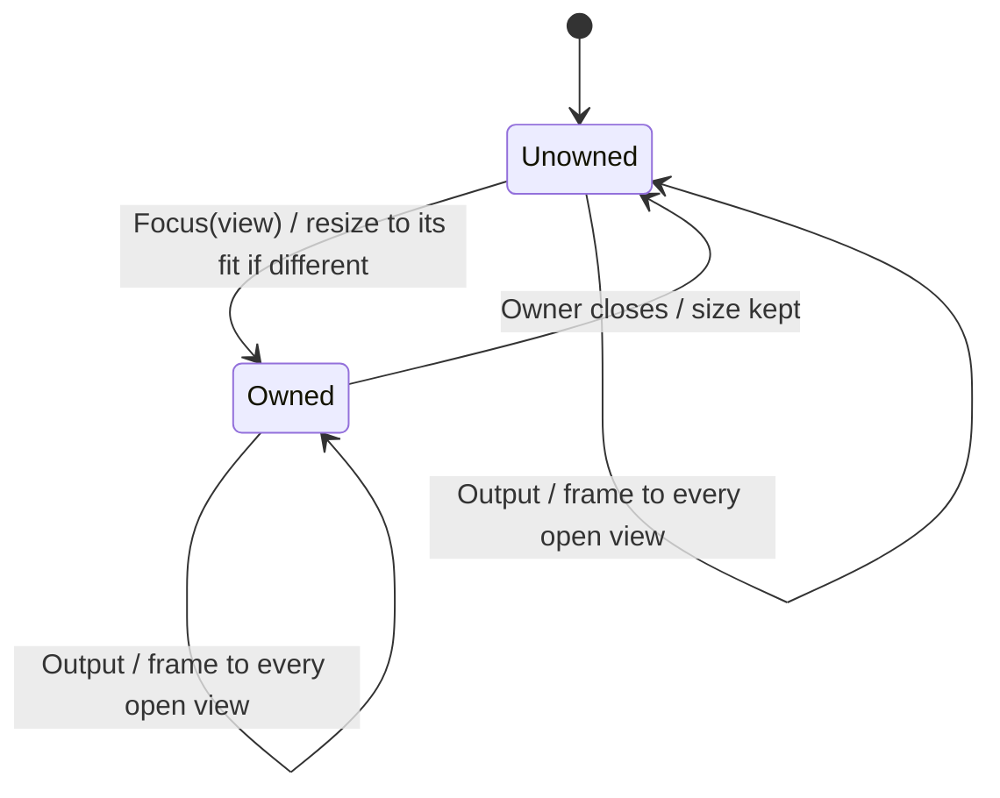

# Share a terminal between views

A terminal session ([#1398](https://github.com/nessalabs/nessa-agent/issues/1398)) can be on screen in more than one place at once: a pane, a second pane split beside it, the inline output under a Run block, and later the phone. The program behind it sees one terminal with one size, so the views must agree on who sets that size, or the screen reflows every time a different view draws it. The rules are in [the terminal design](../../../../design/terminals.md#several-views-of-one-terminal); this page is their state machine.

- **One size owner.** Focusing a view makes it the owner. If its fit (the grid that fills its box) differs from the terminal's size, the terminal is resized to that fit. When any other view's box changes, only its scaling changes. When the owner closes, the size stays as it is until another view takes focus.
- **The server draws the screen.** The cursor, colours and grid come from pty-runtime's terminal model in each frame. A view paints frames in the order they were made and never paints an older one after a newer one. A view that opens gets a checkpoint of the screen as it is, then live frames.
- **Scroll is each view's own.** Scrolling back reads history for that view alone. Another view's scrolling, typing or resizing does not move it.

| Event | Owner | Terminal size | Frames | Other views |
| --- | --- | --- | --- | --- |
| View opens | unchanged | unchanged | checkpoint of the current screen, then live frames | unchanged |
| View focused, fit equals size | becomes this view | unchanged | none | unchanged |
| View focused, fit differs | becomes this view | its fit | one resize frame to every open view | rescale to the new grid |
| Owner's box changes | unchanged | new fit | one resize frame | rescale |
| Another view's box changes | unchanged | unchanged | none | that view rescales only |
| Program output | unchanged | unchanged | one frame to every open view | views at the bottom follow; scrolled views stay |
| View scrolls back or to the bottom | unchanged | unchanged | history read for that view | unchanged |
| Owner closes | none | kept | none | unchanged |
| Other view closes | unchanged | unchanged | its queue dropped | unchanged |

## Reconnect a remote terminal view

A mounted pane for a listed remote terminal keeps its latest measured fit while the gateway is offline. The list retains the gateway's last confirmed terminals through a connection replacement. The next successful list confirms which terminals still exist, and removing a gateway clears its entries immediately. When the gateway connects, the view attaches to the same terminal using its raw ID. An idle pane also reconnects when the workspace adopts a replacement client. The last focused view restores its size ownership. A pending restoration attaches before a later resize or detach reaches the gateway. Keys typed while the owner was offline are discarded. Closing the pane stops future restoration.

The adapter regressions cover opening a pane offline, receipt of the first output, replacement of the owner's terminal source and adopted client, retention of the last focus owner, and closure before or during recovery. [Composite adapter tests](../../../../../src/desktop/workspace/adapters/gateway/multi-terminal-gateway.test.ts) · [Terminal gateway tests](../../../../../src/desktop/workspace/adapters/gateway/terminal-gateway.test.ts) · [Desktop composition tests](../../../../../src/desktop/dependencies.test.ts)

## Bounded rule model

Two views, two fits and up to two frames after the first, starting with both views at the same fit (`StartFit`); a refit reaches the other fit. Transport is a FIFO queue per view, and delivery happens in any order across views. The model checks that the owner is always an open view, that the size is the owner's fit whenever there is an owner, that only the owner ever resizes, that a view never paints an older frame after a newer one, that what a view paints has the server's size for that frame, and that a closed view holds nothing. Not modelled: scrolling (each view's scroll position is its own field, which no other view's action writes), input bytes, history trimming (a scrolled view re-anchors from `total`/`scrollback` in each history reply), parking, and the phone. The model checks design safety, not the implementation, and makes no progress claim.

TLC 1.7.4 checked all seven configured rules across 1,716 distinct states.
The repository probes let another view resize the terminal, keep the owner after
it detaches, and queue an old checkpoint after the latest frame is painted. They
break `OnlyOwnerResizes` and `SizeFollowsOwner`, `OwnerAttached`, and `QueueAhead`,
respectively. [Probe command](../../../../../scripts/state-docs/README.md)

## Model coverage

Disposition: direct model. The bounded rule model section names the modeled owner slice and finite abstraction.

The bounded rule model covers the terminal after its views have attached. Gateway outages and source replacement remain outside its bound.
