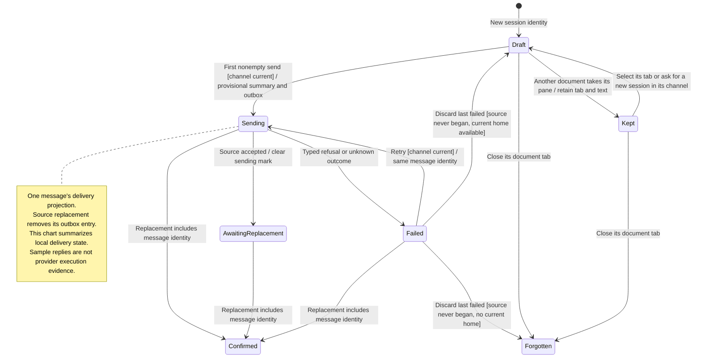

# start a workspace session, send, and retry

A new desktop session begins as a local draft. Sending keeps a stable input ID so a retry can refer to the same message.

A draft keeps its text while its document tab is open, even when another
document occupies its pane. Sending or retrying a local session requires its
channel to remain in the current index. If the source refused its first send,
discarding that message restores the draft in a current channel when one is
available. With no current channel, it removes the local session and any pane
showing it.

The current-channel decision is checked again immediately before a local
message reaches the source. An index can replace the channel list after the
composer stages a message and before the asynchronous delivery continuation.

| Channel when send or retry starts | Channel before source dispatch | Result |
| --- | --- | --- |
| Present | Present | Send the staged message under its stable ID. |
| Missing | Missing | Do not stage or send a message. |
| Present | Missing | Mark the staged message failed with a channel-unavailable explanation; do not call the source. A retry may use the same ID if the channel returns. |
| Present | Removed after source dispatch | Settle from the source's answer or later update; the window cannot retract the request. |

These rows apply to drafts and sessions the source has not confirmed. An
established session is sent under its source-owned identity without a local
`start` channel.

The selected [connection mode](README.md#connection-modes) decides where the message goes. Gateway mode sends through the workspace client; sample mode produces scripted replies. A sample reply does not prove a provider ran.

## Further reading

[Source](../../../../../src/desktop/workspace/application/usecases/sessions.ts) · [Related source](../../../../../src/desktop/workspace/model/session-lifecycle.ts) · [Related tests](../../../../../src/desktop/workspace/application/usecases/sessions.test.ts)
