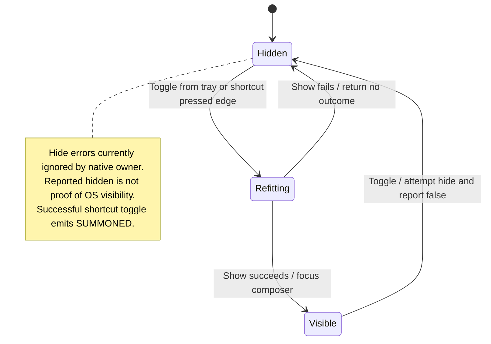

# summon or dismiss the floating panel

The tray action or configured global shortcut shows and hides the floating panel. The native host handles the pressed edge so one key press produces one toggle.

The shortcut belongs to the configured Nessa stage. Showing the panel does not create a new conversation, and hiding it does not stop existing work.

## Further reading

[Source](../../../../../src-tauri/src/tray.rs) · [Related source](../../../../../src-tauri/src/shortcut.rs) · [Related tests](../../../../../src/host/window.test.ts)

## Bounded rule model

Two shortcut presses explore pressed-edge admission, repeated key events and release. Shown is the host requested state, not proof of OS visibility; hide failures are ignored by the source. Tray requests, cross-stage registration, focus, display refitting and native errors remain separate contracts. The model checks design safety, not the implementation. It asserts no liveness and abstracts transport timing into nondeterministic completion order. Regression sources are evidence of intended behavior; this documentation change does not claim their execution.

## Model coverage

Disposition: direct model. The bounded rule model section names the modeled owner slice and finite abstraction.

Excluded: All exclusions stated in the owning Bounded rule model section remain outside verification.

Source review scope: owner entry points and relevant regression declarations were inventoried against frozen source `77a6b620af4d94b234294f6d273fd74b3dfb44c7`. Existing source checkpoints are retained where this was a partial review. A model result establishes bounded design safety only. Browser appearance and interaction were not checked.
