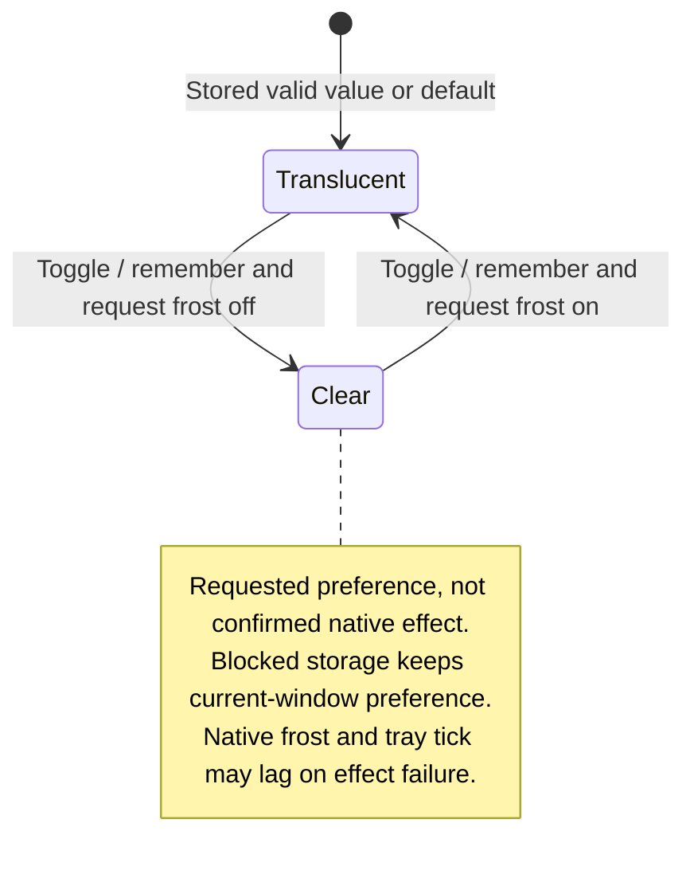

# switch the floating panel's surface

The floating panel can switch its local appearance. The host applies the selected surface style to that window.

This preference is separate from the desktop theme. It changes how the panel looks, not the state of its conversations or agents.

## Further reading

[Source](../../../../../src/panel/adapters/surface.ts) · [Related source](../../../../../src/panel/adapters/host-panel.ts) · [Related tests](../../../../../src/host/window.test.ts)

## Model coverage

Disposition: direct model. The bounded rule model section names this owner, its guarded transitions and the finite design checked. Pure value parsing and geometry stay with the linked source contracts. No claim is made that a checked design is an implementation proof.

The source owner and regression intent were traced at `77a6b620af4d94b234294f6d273fd74b3dfb44c7`; older page checkpoints are retained where the wider journey was only partially re-reviewed. No browser or application-test execution is claimed.

## Bounded rule model

This follows useHostPanel subscription ownership while async listener registration and unmount can arrive in either order. Cleanup marks callbacks stale immediately and removes a listener when registration later resolves. A live toggle changes surface even if remembering fails. setFrosted is a fire-and-forget host effect: no ordered acknowledgement or equality between requested and physical frosting is claimed. The model checks design safety, not the implementation. It asserts no liveness and abstracts transport timing into nondeterministic completion order. Regression sources are evidence of intended behavior; this documentation change does not claim their execution.
