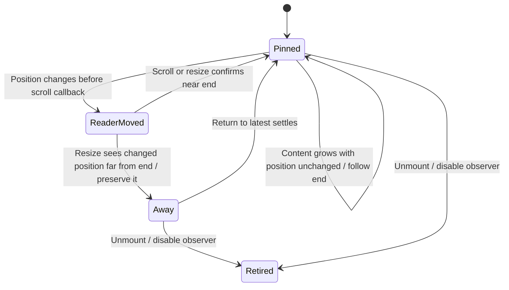

# Keep the reader position when a transcript grows

The desktop transcript remembers whether its reader was close to the end and the scroll position last treated as theirs. Ordinary answer growth leaves scrollTop unchanged; the remembered pin can then keep following new content. Reader movement changes scrollTop before its scroll listener necessarily runs. A resize callback compares actual position with scrollAt and remeasures end distance when they differ, so a delayed scroll event does not pull a reader back from older text.

Scroll and tool-disclosure settlement update both the pin and remembered position. Completing Return to latest also records the current position. Resize cleanup marks the observer inactive before disconnecting it, preventing a retained callback from moving an unmounted transcript. The near-end threshold is 24 pixels; the bounded model uses near/far distances rather than CSS pixels.

This narrow owner was reconciled at source `719dfce93892e09dcb95e86a060b6d2f42c8f3cc`. The regression named pins after observed layout, respects scrolling away, and rejects late delivery exercises growth before a delayed scroll listener and a retained callback after unmount. Its test intent was inspected; no React/browser test run is claimed in this modeling pass. The model assumes no active tool-disclosure hold; that independent helper can suppress following even when pinned. Return animation geometry, text rendering and native scroll physics are excluded.

## Bounded rule model

Two content heights and three scroll positions explore content growth, reader movement before its event, resize remeasurement, explicit return and observer retirement. The stored pin is reused only if actual position still matches the remembered position; otherwise current near-end distance decides. This scope covers the new scrollAt ordering guard, not arbitrary renderer or animated-scroll behavior. The model checks design safety, not the implementation. It asserts no liveness and abstracts transport timing into nondeterministic completion order. Regression sources are evidence of intended behavior; this documentation change does not claim their execution.

## Model coverage

Disposition: direct model. The bounded model covers the exact owner and event ordering described here; the finite analysis bound is not a product capacity or liveness promise.
