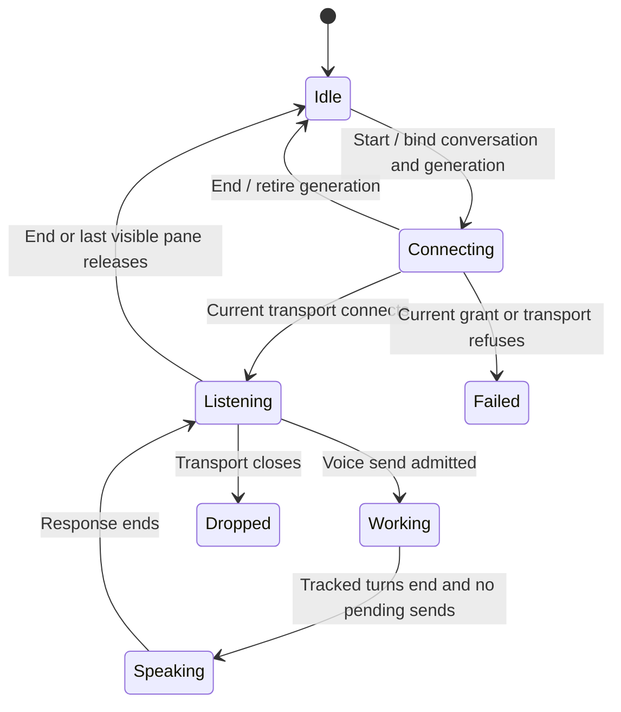

# Talk to a conversation by voice

Starting a call ends its predecessor. The gateway supplies a grant, then the selected realtime transport connects. A refused grant or connection leaves a visible failure. Ending during connection invalidates the call; a late connection is closed. Losing the last pane showing its conversation ends the call.

The coordinator sends committed transcribed words once, in admission order. A send waits up to five seconds for its covered transcripts. A Stop withdraws admitted sends that have not dispatched and waits for a dispatch already underway. Accepted voice turns are tracked separately from messages typed in the composer; their replies wait until all voice turns and pending sends settle. Unknown delivery is said as unknown and is not read out as confirmed work. Microphone mute clears half-heard audio. Speaker mute controls output. End releases timers, watchers, waiters and transport.

The controller tests enumerate V1–V17, including late connection release, ordered transcript waits, stop before dispatch and reply provenance. They were inspected, not executed here. Provider audio capture, transcription quality and physical microphone release are external transport boundaries. The panel composer voice button and the desktop voice call are distinct surfaces.

## Bounded rule model

Two call generations explore end/restart racing with grant/transport completion and refused startup. A late connection belongs to the retired call and is closed. The model excludes transcript ordering, realtime speech scheduling and stop/send serialization, which remain explicit implementation/test scope above. The model checks design safety, not the implementation. It asserts no liveness and abstracts transport timing into nondeterministic completion order. Regression sources are evidence of intended behavior; this documentation change does not claim their execution.

## Model coverage

Disposition: direct model. The bounded rule model section names the modeled owner slice and finite abstraction.

Excluded: All exclusions stated in the owning Bounded rule model section remain outside verification.

Source review scope: owner entry points and relevant regression declarations were inventoried against frozen source `77a6b620af4d94b234294f6d273fd74b3dfb44c7`. Existing source checkpoints are retained where this was a partial review. A model result establishes bounded design safety only. Browser appearance and interaction were not checked.
