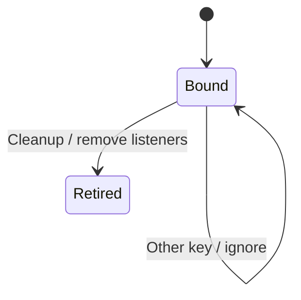

# Keep a local window preference

Theme, icons, layout, motion, tint, framing and on/off window choices use the same stored-preference adapter. Reading missing, invalid or inaccessible storage invokes that preference parser fallback. A choice serializes and attempts a synchronous local-storage write before dispatching its same-window event. That event carries the value, so every mounted reader can apply it even when storage refused the write.

An external storage event for another key is ignored. A matching-key or cleared-storage event rereads current storage rather than replaying the event payload. Cleanup removes both event listeners. These are synchronous browser storage operations, with no version counter, acknowledgement wait or asynchronous write completion to fence. Last successful storage write determines later reload; a failed newer write can leave an older persisted value while current readers show the newer choice. Header image blobs use a different IndexedDB owner and are not stored by this adapter.

The stored-preference tests cover fallback, all local readers, refused writes, unreadable storage and cross-window key filtering. Tests were inspected, not executed by this documentation change.

## Bounded rule model

Two serialized values explore successful/refused storage writes, current-window broadcast, external mutation, matching-key reread and unbinding. Each Choose is atomic at this boundary because JavaScript dispatch and localStorage are synchronous. The model deliberately permits local and persisted values to differ after write refusal; there is no invented version-order guarantee. The model checks design safety, not the implementation. It asserts no liveness and abstracts transport timing into nondeterministic completion order. Regression sources are evidence of intended behavior; this documentation change does not claim their execution.

## Model coverage

Disposition: direct model. The bounded rule model section names this owner, its guarded transitions and the finite design checked. Pure value parsing and geometry stay with the linked source contracts. No claim is made that a checked design is an implementation proof.

The source owner and regression intent were traced at `77a6b620af4d94b234294f6d273fd74b3dfb44c7`; older page checkpoints are retained where the wider journey was only partially re-reviewed. No browser or application-test execution is claimed.
