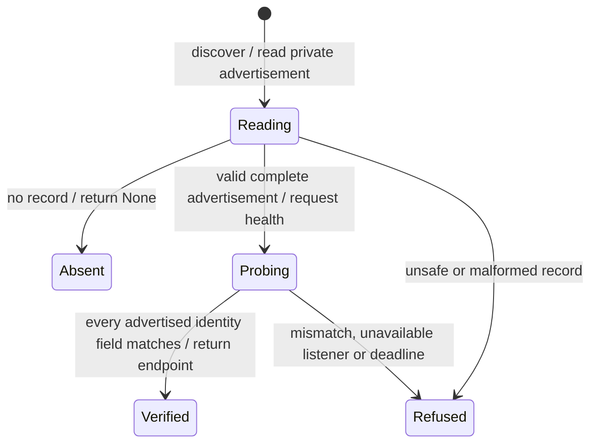

# Publication and discovery

A caller needs the address of the gateway that is actually running. It reads Nessa's private address record, then checks the live gateway against that record.

The address, instance and process identity must agree. When managed-service details are present, they must form a complete matching set. This confirms which gateway was found; authentication is still required. Some callers can fall back when no discovery record exists, so absence is not itself a successful validation.

## Further reading

[Source](../../../../crates/nessa-gateway-endpoint/src/application/publish.rs) · [Related source](../../../../crates/nessa-gateway-endpoint/src/infrastructure/file.rs)

## Model coverage

Direct model: One private advertisement and health probe; complete managed identity and address/instance/process equality are required before discovery succeeds.

The finite model checks safety only. Parsing, deadlines, actual process identity and TCP ownership are external predicates. No authentication or availability guarantee; publication uses storage-publication. Terminal states may stutter; no eventual completion or implementation proof is claimed.

This is a scoped source review at `77a6b620af4d94b234294f6d273fd74b3dfb44c7`. It adds the stated abstraction and does not refresh all earlier narrative claims. Existing page checkpoints are retained where present; reading regression sources is not a test run.
