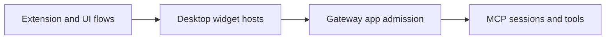

# Extensions and UI integration

Extensions can give tools interactive views, and Nessa UI provides reusable app components. The gateway owns tool permission; the desktop owns the displayed app and its host bridge.

Examples and sibling packages have their own verification limits. The desktop connects server apps in gateway mode and keeps fixture apps in sample mode. See [connection modes](../desktop/workspace/README.md#connection-modes).

## Owner map

These boxes open related pages. They are parts of the system, rather than mutually exclusive runtime states.

## Browse this area

- [Extensions and UI](ui/README.md)

## Model coverage

Disposition: component index. Navigation and ownership index, not an independent runtime state machine.

Excluded: Each linked feature retains its own model and source scope.

Source review scope: owner entry points and relevant regression declarations were inventoried against frozen source `77a6b620af4d94b234294f6d273fd74b3dfb44c7`. Existing source checkpoints are retained where this was a partial review. A model result establishes bounded design safety only. Browser appearance and interaction were not checked.
