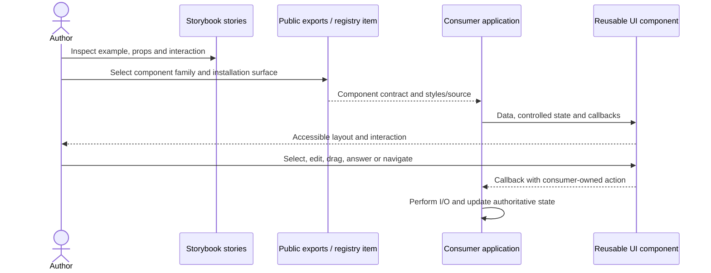

# discover reusable UI families for an application

Nessa UI groups components for common app needs such as chat, navigation, settings and agent activity. Choose a family, then use its packages or registry source in the app.

This is a component catalogue, not a list of shipped Nessa features. The consuming app supplies its data and effects. A reusable component has no independent service lifecycle just because it appears here.

## Model coverage

Disposition: external-source boundary. This is a reference contract for a sibling UI/extension/workshop package rather than a shipped Nessa lifecycle.

Excluded: The owning sibling source was not part of the frozen Nessa source checkpoint. No sourceRevision or TLA+ coverage of that external implementation is claimed.

Source review scope: owner entry points and relevant regression declarations were inventoried against frozen source `77a6b620af4d94b234294f6d273fd74b3dfb44c7`. Existing source checkpoints are retained where this was a partial review. A model result establishes bounded design safety only. Browser appearance and interaction were not checked.
