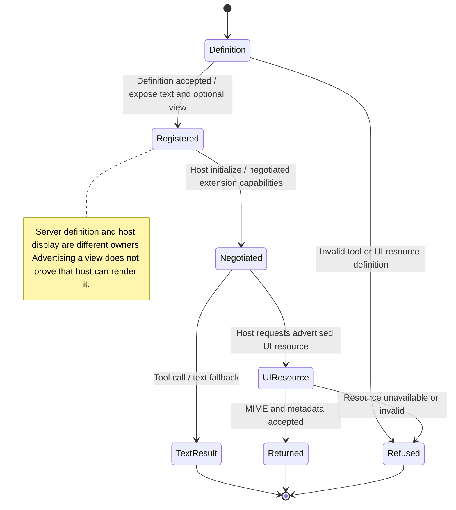

# expose an extension tool with a view and text fallback

An extension can publish a tool with both a text result and an optional interactive view. A host that supports MCP Apps can open the view; other callers can still read the text.

The server library checks tool and view definitions. It supports its documented stdio and loopback HTTP transports. Older consumers may support only stdio. The host still decides which tool calls and device permissions are allowed.

## Model coverage

Disposition: external-source boundary. This is a reference contract for a sibling UI/extension/workshop package rather than a shipped Nessa lifecycle.

Excluded: The owning sibling source was not part of the frozen Nessa source checkpoint. No sourceRevision or TLA+ coverage of that external implementation is claimed.

Source review scope: owner entry points and relevant regression declarations were inventoried against frozen source `77a6b620af4d94b234294f6d273fd74b3dfb44c7`. Existing source checkpoints are retained where this was a partial review. A model result establishes bounded design safety only. Browser appearance and interaction were not checked.
