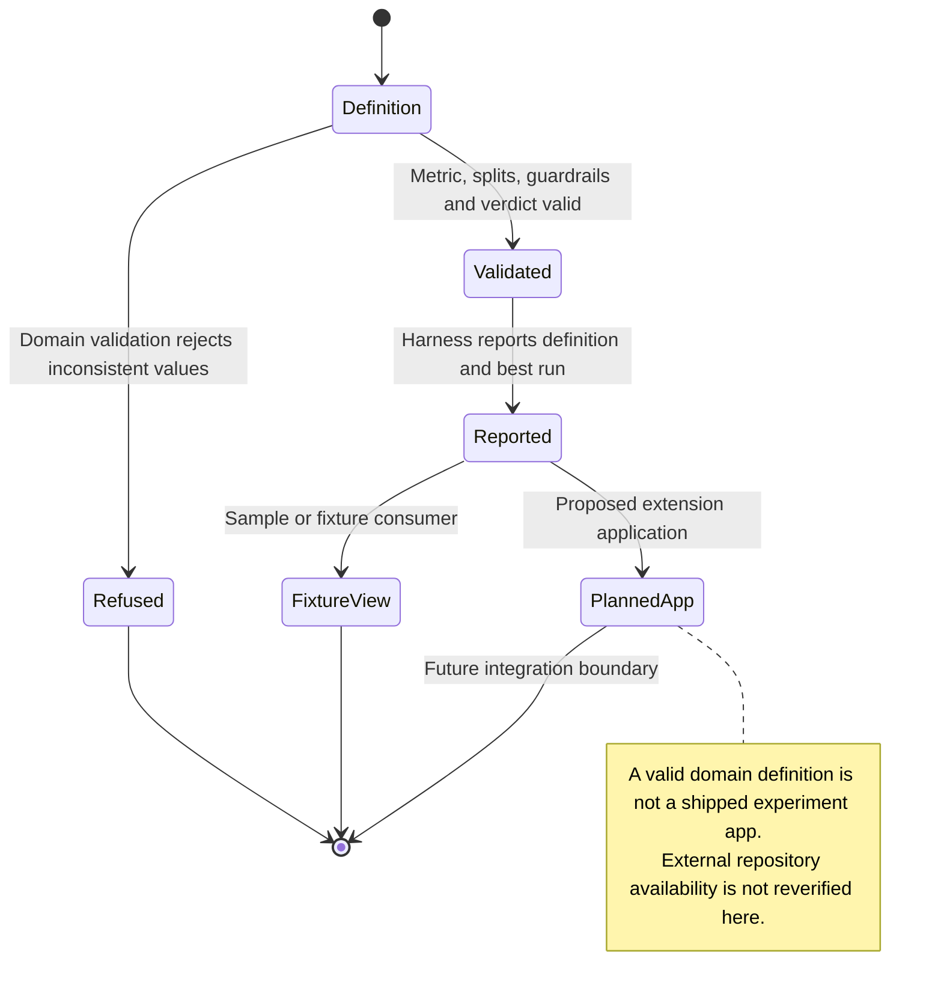

# inspect experiment results through a validated definition

An experiment definition says what is being compared and how each measure should be interpreted. Validation checks that its results match that definition before a view displays them.

A higher number is not always better. The declared direction of a measure and the recorded decision must be kept. The experiments domain and examples exist, but they do not establish a runnable production experiment app and server.

## Model coverage

Disposition: external-source boundary. This is a reference contract for a sibling UI/extension/workshop package rather than a shipped Nessa lifecycle.

Excluded: The owning sibling source was not part of the frozen Nessa source checkpoint. No sourceRevision or TLA+ coverage of that external implementation is claimed.

Source review scope: owner entry points and relevant regression declarations were inventoried against frozen source `77a6b620af4d94b234294f6d273fd74b3dfb44c7`. Existing source checkpoints are retained where this was a partial review. A model result establishes bounded design safety only. Browser appearance and interaction were not checked.
