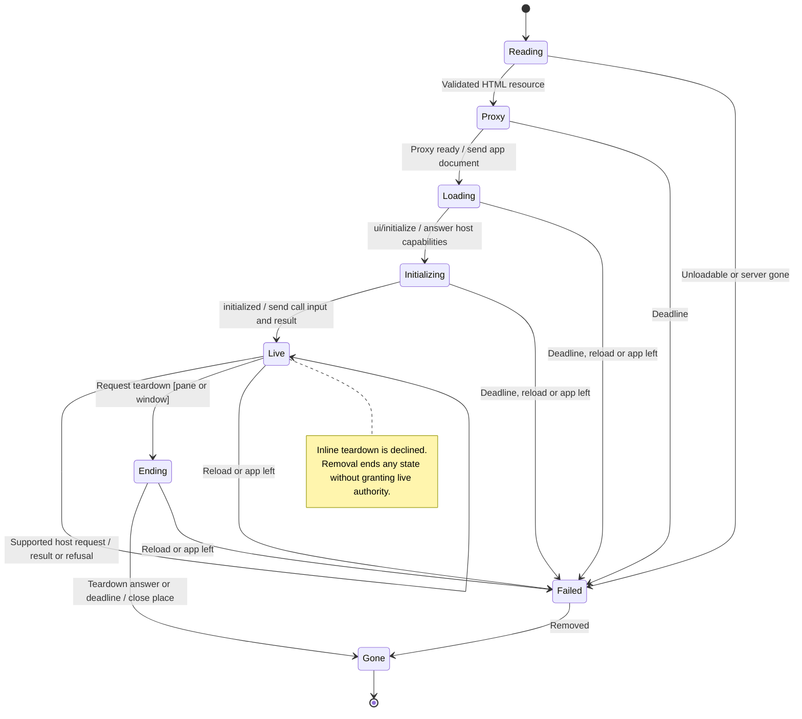

# open a tool's MCP App and interact with its host

A tool can offer an interactive MCP App alongside its result. Nessa loads the app in an isolated view and provides a bridge for allowed host interactions.

The desktop renderer, frame lifecycle and bridge work with server apps in gateway mode and a fixture in sample mode. Tool approval and device access are separate decisions; opening the view does not grant either automatically.

## Further reading

[Source](../../../../adr/done/344-mcp-ui.md) · [Related source](../../../../../src/desktop/widgets/ui/plugin.ts) · [Related tests](../../../../../src/desktop/widgets/ui/hosts.test.tsx)

## Model coverage

Disposition: shared owner model. The owning mount/session/resource lifecycle is modeled at [desktop-mcp-app-view](../../desktop/workspace/mcp-app-view-lifecycle.md).

Excluded: Tool UI metadata is an immutable discovery contract. Gateway authorization, approval review and ticket consumption require their own owner models; this journey is not itself executable proof.

Source review scope: owner entry points and relevant regression declarations were inventoried against frozen source `77a6b620af4d94b234294f6d273fd74b3dfb44c7`. Existing source checkpoints are retained where this was a partial review. A model result establishes bounded design safety only. Browser appearance and interaction were not checked.
