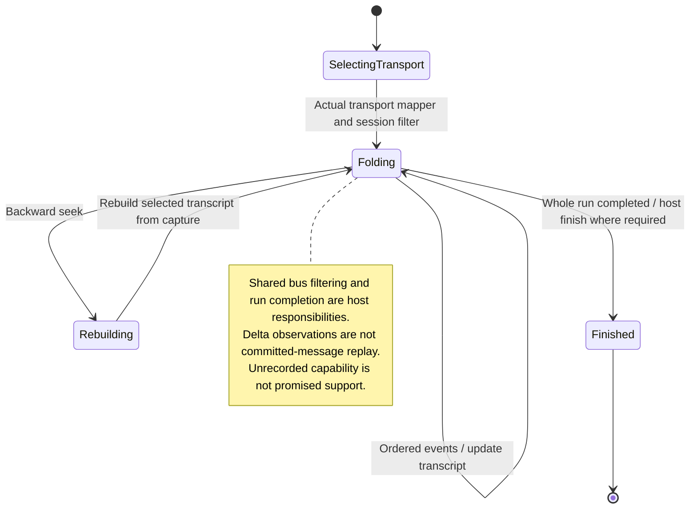

# replay or render an agent stream in the workshop or a consumer app

A stream of agent events can be replayed in the workshop or rendered by a consuming app. The parser turns those events into messages, tool activity and waiting requests for the UI.

Rendering a recorded stream does not run the agent again. The consuming app owns live transport, state and actions. Workshop examples demonstrate the component behavior rather than a production session.

## Model coverage

Disposition: external-source boundary. This is a reference contract for a sibling UI/extension/workshop package rather than a shipped Nessa lifecycle.

Excluded: The owning sibling source was not part of the frozen Nessa source checkpoint. No sourceRevision or TLA+ coverage of that external implementation is claimed.

Source review scope: owner entry points and relevant regression declarations were inventoried against frozen source `77a6b620af4d94b234294f6d273fd74b3dfb44c7`. Existing source checkpoints are retained where this was a partial review. A model result establishes bounded design safety only. Browser appearance and interaction were not checked.
