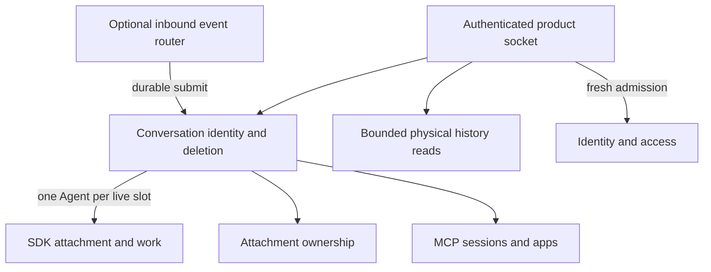

# Local gateway

The local gateway receives authenticated Nessa commands. It owns conversations, checks access and coordinates agents, stored history, images and app tool calls.

It can accept work before an agent is ready. Current views, command replies and deletion progress each describe different parts of that work.

## Owner map

These boxes open related pages. They are parts of the system, rather than mutually exclusive runtime states.

## Browse this area

- [GitHub reads](github-reads.md)
- [Background tasks](background-tasks.md)
- [External event admission](external-events.md)
- [Attachments and content](attachments/README.md)
- [Conversation identity and deletion](conversation.md)
- [Bounded physical history reads](record-reads.md)
- [Outbound webhook foundation and remaining integration](webhook-foundation.md)
- [Outbound webhook credential and principal admission](webhook-admission.md)
- [Webhook credential issuance and receipt identity](webhook-issuance.md)
- [Durable outbound webhook state and audit](webhook-outbox.md)

[Channel workspaces](channel-workspaces.md) describes independent Local/Boat
placement, durable VM assignments, approved local access and main-chat replacement.

## Model coverage

This component index routes to the feature owners. Their finite models check only the safety slices stated on each owner page; no single aggregate application lifecycle is claimed. Source checkpoints do not inherit to child pages.

## Additional gateway feature owners

These operations have separate admission and resource lifetimes. Their bounded
models link back to the source that owns those decisions.

- [Export a consistent backup cut](backup-export.md)
- [Verify, quarantine and accept a backup](backup-restore.md)
- [Delegate to another agent thread](agent-thread-tools.md)
- [Enroll, read and forget peer gateways](peer-gateways.md)
- [Run harnesses through environment leases](environment-leases.md)
- [Reach a gateway through a tunnel](tunnel-connectivity.md)
- [Pair a device through current receiver holding](device-pairing.md)
- [Pair a gateway as the same person and recover attribution](same-person.md)
- [Stop captured parent and descendant turns](parent-stop.md)
- [Call a gateway method from the CLI or MCP](call-a-method-from-the-cli-or-mcp.md)

[Busy record discovery](record-read-discovery.md) owns the distinction between
occupied cache checkout, validation progress and the active work budget. An
occupied stream waits for its own release rather than ending a watch or waiting
for every unrelated stream.
