# Delegate to another agent thread

The built-in thread tools create a child, send a message, subscribe to committed output or stop a selected thread through existing target operations. Tool arguments cannot manufacture source authority. The gateway derives the caller from the live source turn, reads current resource metadata, asks Cedar and records that decision before returning a source-bound capability.

Losing the response does not release a detached admission still awaiting metadata or audit. Each source has eight physical admissions; waiting subscriptions have a separate bound of four and use committed readers rather than opening an Agent. Target commands retain their own authorization, durable receipts, permissions and Stop behavior.

```mermaid
stateDiagram-v2
    [*] --> Idle
    Idle --> Resolving: reserve source admission
    Resolving --> Decided: verified turn and Cedar result
    Decided --> Audited: decision saved
    Decided --> Refused: audit fails
    Audited --> Authorized: allowed and not stopped; release source permit
    Authorized --> Dispatched: existing target owner
    Audited --> Refused: denied or stopped
    Dispatched --> Done: target operation finishes
```

## Bounded rule model

One detached source admission explores cancellation and response loss around policy and audit. Its physical source permit ends when authorization returns; the later target operation is not charged to that permit. Cedar is an injected decision, not a reimplementation of authorization policy. The stop invariant concerns capability admission. A stop after the capability is returned does not retroactively revoke it in this abstraction; target dispatch and cleanup have their own owners.

The configured safety rules are `EffectHasAuthority`, `NoCapabilityAfterObservedStop`, `CallerLossKeepsOwnedAdmission`, `SourcePermitEndsAtAuthorization`. TLC explores the authored abstraction; it does not execute or prove the implementation.

| Model action | Source behavior abstracted |
| --- | --- |
| `Reserve` | Reserve a physical source admission before detached source resolution. |
| `Allow` | Resolve a running source turn and receive Cedar allowance over freshly read metadata. |
| `Deny` | Retain a typed policy denial for audit without granting target authority. |
| `Audit` | Save the source turn, caller, request and target decision before effects. |
| `AuditFails` | Refuse target dispatch when admission audit fails. |
| `Stop` | Observe source cancellation without freeing a still-owned physical admission. |
| `Disconnect` | Lose the response observer while detached admission remains owned. |
| `Authorize` | Return the audited capability and release the source-admission permit. |
| `Dispatch` | Delegate through the existing target owner only after audited live-source admission. |
| `Refuse` | Refuse a denied or cancelled source before target effects. |
| `Finish` | Observe target completion under the separate target owner. |

## Verification limits

The model omits target scheduling, multi-source capacity, command receipt deduplication, report continuation chains, actual subscription cursors and transport framing. Those remain distinct owners, including SDK scheduling and product parent Stop. The cited code and regression sources were inspected at the page checkpoint; their product test suites were not run in this modeling pass.

## Further reading

[agent_tools.rs](../../../../crates/nessa-server/src/conversation/application/service/agent_tools.rs) · [agent_tools.rs](../../../../crates/nessa-server/tests/conversation/agent_tools.rs) · [agent_tools.rs](../../../../crates/nessa-server/src/conversation/application/agent_tools.rs)
