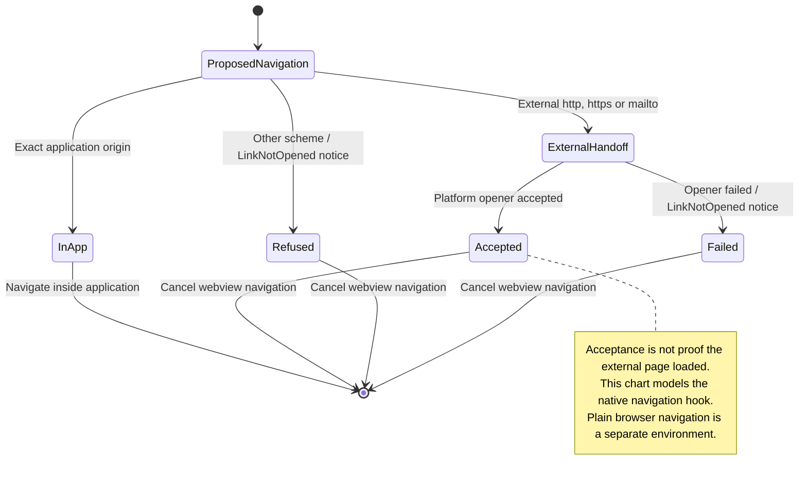

# Open a link without replacing the app

In a native Nessa window, external web and mail links are handed to the system opener. App-owned addresses stay inside Nessa; unsupported schemes are refused. A failed handoff shows a dismissible notice in the panel.

An accepted handoff does not prove the destination loaded. Some new-window, download and platform navigation paths fall outside this hook. Plain browsers have different navigation behavior, and another native surface needs its own notice subscription.

An MCP app runs inside a sandbox proxy. Its default CSP blocks the app's own
external frame navigation before the native hook decides whether to hand a URL
to the system opener. A bundled macOS WKWebView probe saw CSP violations for
script navigation, meta refresh and a rewritten document targeting HTTP, and
for script navigation targeting HTTPS and `mailto:`. None reached the hook;
a clicked link in the host page did. The [native probe evidence](../../../../../verification/desktop/evidence/1192-webkit-navigation/README.md)
records its debug-bundle scope and screenshots. This review checked the hook,
platform openers, panel notice, sandbox CSP and proxy at the source revision
above. It did not retest new-window or download paths.

## Further reading

[Source](../../../../../src-tauri/src/links.rs) · [Related source](../../../../../src-tauri/src/platform/mod.rs) · [Related tests](../../../../../src/panel/application/link-notice.test.ts)

## Model coverage

Disposition: direct model. The bounded model checks the explicitly scoped local operation or renderer consumer contract below. It does not execute native effects, React or absent sibling renderer internals. Existing source checkpoints remain unchanged after this scoped review.

## Bounded rule model

The model uses the pure native classifier result as an operation parameter: own origin/frame, external HTTP/HTTPS/mail, or unsupported scheme. Two navigation identities keep opener acknowledgements, refusals and notice payloads distinct. Only external web/mail reaches the opener; only allowed app addresses navigate this webview. Accepted handoff is not a loaded-page state and cannot create a failure notice. The mounted panel retains the most recently delivered failure notice and ignores callbacks after retirement. Dismiss does not prevent a subsequent failure event from showing a notice. Source boundaries are decide/apply/report in links.rs and the usePanelLinkNotice stale-subscription guard. OS destination loading and which native navigation paths invoke the hook remain external platform boundaries. The model checks design safety, not the implementation. It asserts no liveness and abstracts transport timing into nondeterministic completion order. Regression sources are evidence of intended behavior; this documentation change does not claim their execution.
