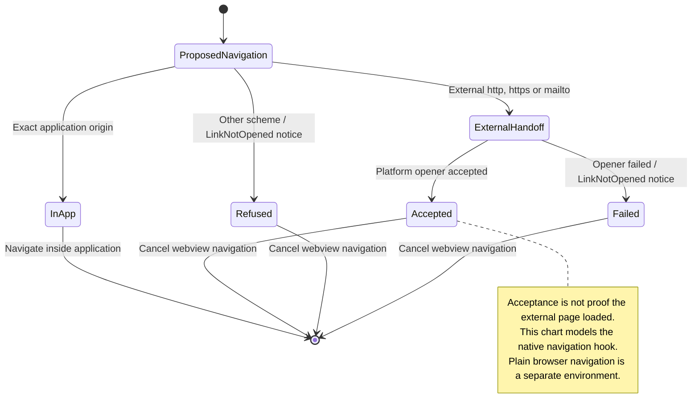

# Open a link without replacing the app

In a native Nessa window, external web and mail links are handed to the system opener. App-owned addresses stay inside Nessa; unsupported schemes are refused. A failed handoff shows a dismissible notice in the panel.

An accepted handoff does not prove the destination loaded. Some new-window, download and platform navigation paths fall outside this hook. Plain browsers have different navigation behavior, and another native surface needs its own notice subscription.

An MCP app runs inside a sandbox proxy. Its default CSP blocks the app's own
external frame navigation before the native hook decides whether to hand a URL
to the system opener. A bundled macOS WKWebView probe saw CSP violations for
script navigation, meta refresh and a rewritten document targeting HTTP, and
for script navigation targeting HTTPS and `mailto:`. None reached the hook;
a clicked link in the host page did. The [native probe evidence](../../../../../verification/desktop/evidence/1192-webkit-navigation/README.md)
records its debug-bundle scope and screenshots. This review checked the hook,
platform openers, panel notice, sandbox CSP and proxy at the source revision
above. It did not retest new-window or download paths.

## Further reading

[Source](../../../../../src-tauri/src/links.rs) · [Related source](../../../../../src-tauri/src/platform/mod.rs) · [Related tests](../../../../../src/panel/application/link-notice.test.ts)
