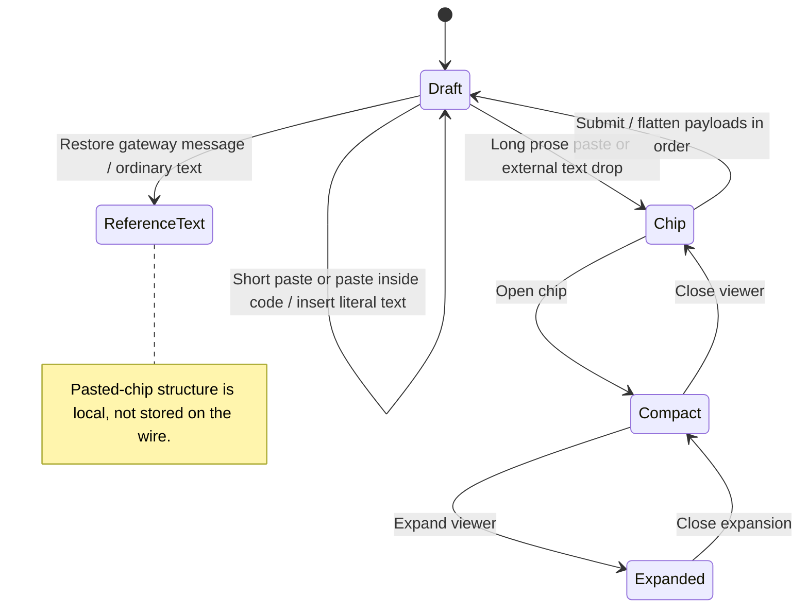

# Paste text or code and inspect the full pasted payload

Short pasted text enters the editor directly. A paste of 500 JavaScript string units or more becomes a chip you can open to inspect the full text. Pasting inside a code block keeps the text in that block. Clipboard text takes priority over clipboard files.

Send combines the text and chip contents in their original order. Switching tabs restores each draft's chips. Reopened gateway history contains the combined text and attachment references, so it cannot recreate the original chip layout.

## Further reading

[Source](../../../../../src/panel/ui/use-composer.ts) · [Related source](../../../../../src/conversation/ui/composer-content.ts) · [Related tests](../../../../../src/conversation/ui/composer-content.test.ts)

## Bounded rule model

Owns original pasted payload retention, viewer capture to its opening conversation, tab-switch hiding through the owner/active projection, and payload rather than label submission. Declined submit is a stutter retaining the draft. The configured 500-unit paste threshold and code-block classification are editor-component contracts; this model does not verify their implementation, dialog expansion rendering or general draft persistence. Scoped source review inspected the local hook and panel viewer binding; prior page checkpoints remain unchanged. This finite abstraction checks safety only. It does not execute or verify the implementation, promise eventual completion, or qualify external effects. Existing source checkpoints and historical test receipts retain their earlier scope. The scoped model review inspected `src/panel/ui/use-composer.ts`, `src/panel/ui/app.tsx`, `src/conversation/ui/composer-content.ts`, `src/conversation/model/content.ts`.
