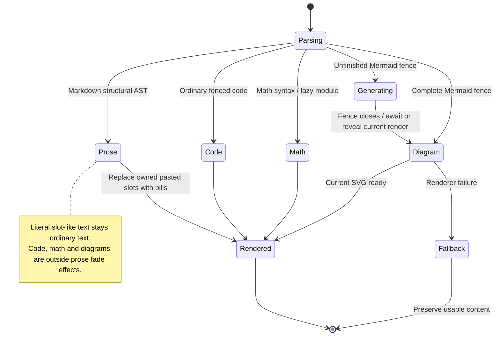

# Read rich text, code, math, and diagrams in a message

The floating panel renders Markdown, code, math and diagrams using the shared UI components. A diagram still being streamed shows a generating placeholder until its fence closes and the current diagram render settles.

Pasted-text chips and attachment tiles stay separate from the surrounding Markdown. Raw HTML is not enabled. Copy uses the original content, rather than text reconstructed from the rendered view. The desktop supplies different local wrappers around the same shared Markdown renderer; capabilities still depend on that pinned component.

## Further reading

[Source](../../../../../src/conversation/ui/message-content.tsx) · [Related source](../../../../../src/conversation/ui/transcript.tsx) · [Related tests](../../../../../src/conversation/ui/message-content.test.ts)

## Model coverage

Disposition: direct model. The pinned shared Markdown and Mermaid sources were read at their exact dependency revision. The bounded model follows two source generations, delayed render work, component retirement and page-wide queue quarantine. It checks the implemented design abstraction, not React execution or generated SVG correctness.

## Bounded rule model

A closed Mermaid fence is not a prerequisite to starting render work. The component debounces chart changes by 250 milliseconds, so a quiet prefix may render while its fence is open. The open-fence streaming flag keeps that result behind the generating surface. Once this instance has streamed, a changed chart remains generating until its own render answers or its final source fails. A successful current chart wins over a later failure, such as a failed theme rerender. A failed final chart falls back to its raw source rather than showing a stale prefix as complete.

Each chart/theme effect owns a cancellation flag. Cleanup clears its debounce timer and prevents an old callback from publishing. Queued work checks that flag before it initializes Mermaid. Active work cannot be physically cancelled: its queue-owned ten-second deadline survives component cleanup. Timeout quarantines the global renderer until that exact hung promise settles; later callers receive a quarantine refusal without changing the configuration still owned by the hung render. The model abstracts chart/theme effect identities into two generations and treats fence closure as the parser's published decision. It asserts safety only, with no liveness claim.

The source remains available for copy and fallback. Pasted slots, raw HTML exclusion, source copy, known-chat pills and code/math formatting are representation contracts in the linked local wrappers. The sibling MathBlock keeps last-good output only for the same inline/display mode. Suspense's lazy-load fallback preserves source while optional math/diagram code loads. Diagram viewer geometry and SVG pixel correctness are outside this model.

## Inspected source and dependency checkpoint

Local sources were traced at `77a6b620af4d94b234294f6d273fd74b3dfb44c7`. Both panel and desktop pass text to the shared MessageMarkdown; their local wrappers and pacing differ. The package pinned by `nessa-ui-revision` was read through authenticated repository contents at `a32191c26ee27c2d8159ab6498a0f0530a93e3ea`: [fence classification and lazy routing](https://github.com/nessalabs/nessa_ui/blob/a32191c26ee27c2d8159ab6498a0f0530a93e3ea/packages/react/src/components/message-markdown.tsx), [component cancellation and reveal](https://github.com/nessalabs/nessa_ui/blob/a32191c26ee27c2d8159ab6498a0f0530a93e3ea/packages/react/src/components/mermaid-diagram.tsx), [serialized render ownership](https://github.com/nessalabs/nessa_ui/blob/a32191c26ee27c2d8159ab6498a0f0530a93e3ea/packages/react/src/components/mermaid-render-queue.ts) and its [controlled-clock regressions](https://github.com/nessalabs/nessa_ui/blob/a32191c26ee27c2d8159ab6498a0f0530a93e3ea/packages/react/src/components/mermaid-render-queue.test.ts).

Fence closure requires a matching delimiter with at least the opening run's length, accepting LF or CR and container prefixes. Missing source offsets are treated as complete; a nonstreaming host retains the original keep-last-render behavior. The model bounds the streaming-latched case and does not claim all diagrams use that mode. All eight pinned queue tests passed under the bundled Node runtime after TypeScript transpilation into an isolated work directory. They use controlled clocks and promises; they do not execute React, Mermaid SVG layout or a browser. No renderer browser, SVG or visual test was run. The page's wider source checkpoint is retained after this scoped review.
