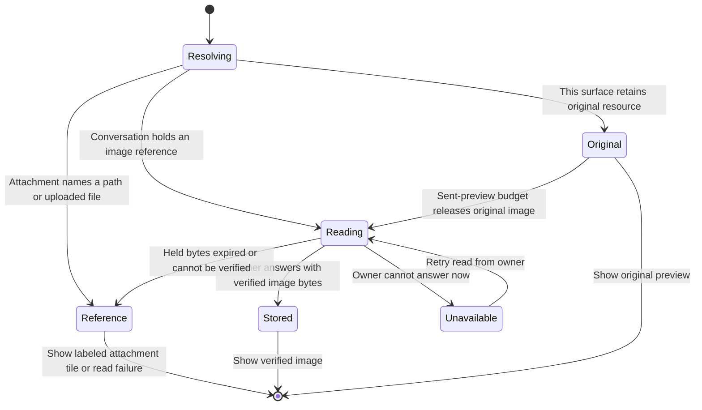

# Reopen a message and understand its reference-only attachments

A message sent from this window can still display its original local attachments. Reopened history contains image references, local file paths and original uploaded-file references, rather than all the original bytes. Uploaded-file tiles preserve the sender's name; a materialized execution path never replaces that identity.

After reload, another surface's send, or release of the local preview budget, an image reference can retrieve the stored image. The tile shows the bytes after the client verifies them. The desktop sends the raw conversation ID and the file reference to the gateway that owns the conversation. An unavailable owner means the read can be retried after it reconnects. Agent-published files use the same read route when someone downloads them. A local path or uploaded-file reference on a sent message remains a labeled tile.

## Further reading

[Message image rendering](../../../../../src/conversation/ui/message-images.tsx) · [Desktop routing regression](../../../../../src/desktop/dependencies.test.ts)

## Model coverage

The shared model covers ownership of local retained previews. Held-file reads, byte verification, downloads, and gateway routing are outside its bound. [Preview or remove a draft attachment](preview-or-remove-a-draft-attachment.md)
