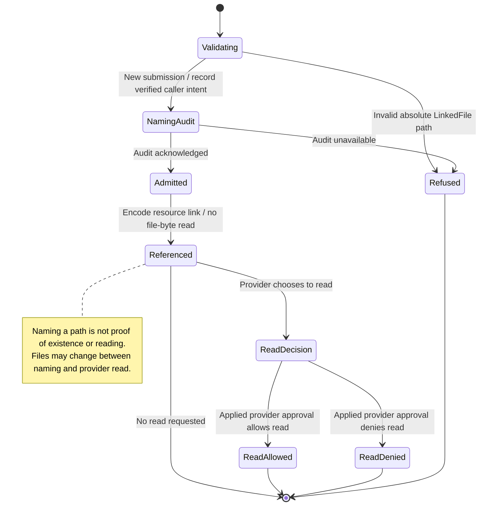

# Send a non-image file by path and approve its read

A native file attachment sends its absolute path, not its contents. Nessa checks the path's shape but does not open the file, check its existence or restrict it to the workspace at this step.

The agent decides how to read the file under its applied approval mode. Ask mode can request permission; another mode can behave differently. Attaching a path does not prove a prompt appeared, that the file was read, or that its contents stayed unchanged.

## Further reading

[Source](../../../../adr/done/0013-files-by-path-not-by-payload.md) · [Related source](../../../../../src/conversation/model/attachments.ts) · [Related tests](../../../../../crates/nessa-server/tests/conversation/linked_files.rs)

## Bounded rule model

Owns durable path-naming evidence before submission. The model intentionally has no file-read action: path attachment does not prove permission, existence or read. LinkedFile path syntax is a pure contract; actual agent read and approval belong to the SDK/tool permission owner. This finite abstraction checks safety only. It does not execute or verify the implementation, promise eventual completion, or qualify external effects. Existing source checkpoints and historical test receipts retain their earlier scope. The scoped model review inspected `crates/nessa-server/src/conversation/infrastructure/file_link_audit.rs`, `crates/nessa-server/src/conversation/application/service.rs`.
