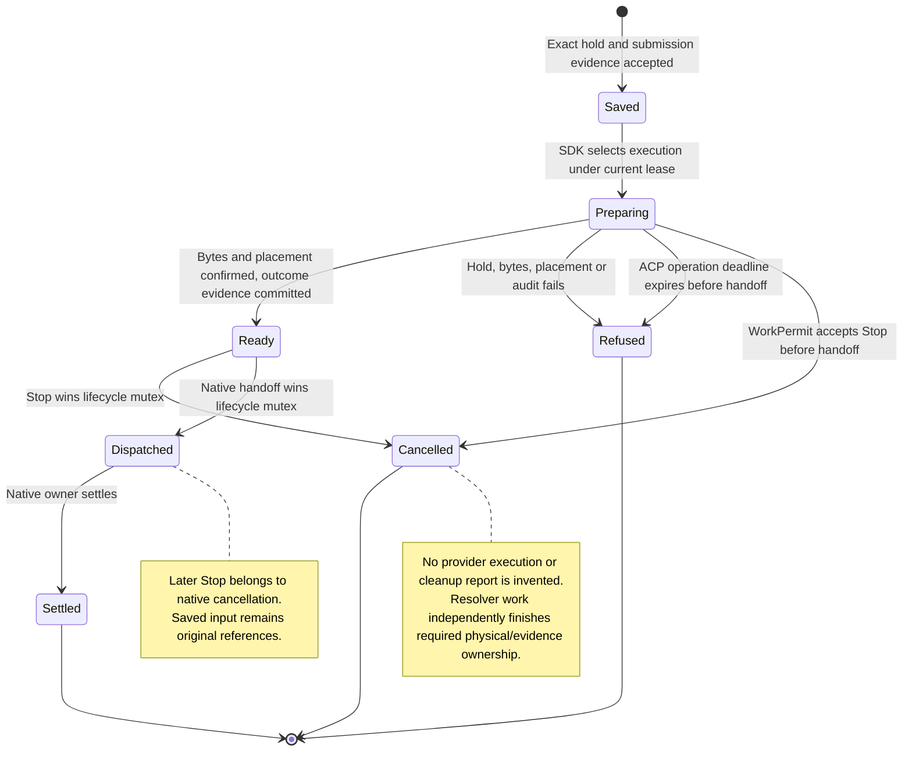

# Send an uploaded file from the phone

This follows one accepted execution with original uploaded-file references.
The phone sends digest, media type, size and display name after its piecewise
upload completes. Admission requires that exact conversation hold and sender
evidence. SDK storage keeps the original references through queuing, receipt
lookup and restoration. The phone's two journals retain the same facts.

The phone captures one scope owner for its transport, outbox and Stop journal;
request admission verifies that scope before any upload, send or lookup.

At dispatch, a resolver bound to the current conversation and lease prepares
an ephemeral input copy. Its local workspace is the canonical path selected by
the same provider generation; selecting a path alias does not change placement.
Local placement is offered on Unix hosts under the existing POSIX path contract;
other hosts return `NotOffered` before filesystem or byte reads.
The selected root is caller trust, as for private-root acquisition; writable
locator ancestry does not reject it. Current ownership, no group/other write
bits, no-follow and retained binding checks remain required.
Local retained-handle placement or SSH fetch verifies
the bytes and refuses an unrelated existing destination. Required outcome
evidence precedes dispatch. All ACP profiles receive resource links to confirmed
paths. Display names never select directories, and the transcript keeps the
original metadata. The paired execution-environment link currently refuses file
placement; the phone's upload link is a separate transport.

Read ranges and audit calls have ten-second waits. A resolver caller waits at
most two minutes. Losing the waiter signals cancellation while the retained
worker owns placement and evidence until they settle. An uncertain outcome
cannot authorize a provider prompt. ACP arms its execution or steering deadline
before preparing files, and image reads and native response waits spend what
remains of that same deadline. Expiry before native handoff rejects the input
without inventing provider execution or cleanup evidence. A resolver's error
cannot retire the native context: only the backend's own close/channel evidence
can require cleanup. Known source failures remain the primary cause even when
expiry or real context loss is also observed. The shared clock helper and control
waits stay observable when a ready source exhausts Tokio's cooperative budget.

The production Swift `FileVerification --files` runner and desktop `inputFiles`
stress step exercise sending. The stress step invokes the actual Swift journal
and outbox in its loaded conversation. The private iOS repository owns the
macOS CI run against pinned public gateway source; the Ubuntu core stress job
explicitly excludes the phone step. The SSH test uses an in-process environment loop
and scripted SFTP channel; it does not claim a live SSH daemon or model service.

## Further reading

[Delivery design](../../../../design/phone-file-uploads.md) ·
[Reference-only history](reopen-a-message-and-understand-its-reference-only-attachments.md)

## Bounded rule model

Owns asked-before-placement evidence, retained execution lease identity and outcome ownership after waiter loss. Original uploaded references do not become execution paths. Exact hold verification, local/remote filesystem safety, deadline and provider dispatch correlation are excluded. This finite abstraction checks safety only. It does not execute or verify the implementation, promise eventual completion, or qualify external effects. Existing source checkpoints and historical test receipts retain their earlier scope. The scoped model review inspected `crates/nessa-conversation/src/application/input_files.rs`.
