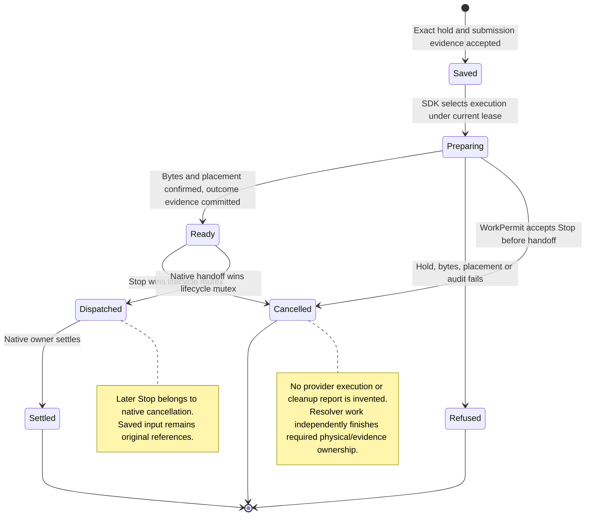

# Send an uploaded file from the phone

This follows one accepted execution with original uploaded-file references.
The phone sends digest, media type, size and display name after its piecewise
upload completes. Admission requires that exact conversation hold and sender
evidence. SDK storage keeps the original references through queuing, receipt
lookup and restoration. The phone's two journals retain the same facts.

The phone captures one scope owner for its transport, outbox and Stop journal;
request admission verifies that scope before any upload, send or lookup.

At dispatch, a resolver bound to the current conversation and lease prepares
an ephemeral input copy. Its local workspace is the canonical path selected by
the same provider generation; selecting a path alias does not change placement.
Local retained-handle placement or SSH fetch verifies
the bytes and refuses an unrelated existing destination. Required outcome
evidence precedes dispatch. All ACP profiles receive resource links to confirmed
paths. Display names never select directories, and the transcript keeps the
original metadata. The paired execution-environment link currently refuses file
placement; the phone's upload link is a separate transport.

Read ranges and audit calls have ten-second waits. A resolver caller waits at
most two minutes. Losing the waiter signals cancellation while the retained
worker owns placement and evidence until they settle. An uncertain outcome
cannot authorize a provider prompt.

The production Swift `FileVerification --files` runner and desktop `inputFiles`
stress step exercise sending. The SSH test uses an in-process environment loop
and scripted SFTP channel; it does not claim a live SSH daemon or model service.

## Further reading

[Delivery design](../../../../design/phone-file-uploads.md) ·
[Reference-only history](reopen-a-message-and-understand-its-reference-only-attachments.md)
