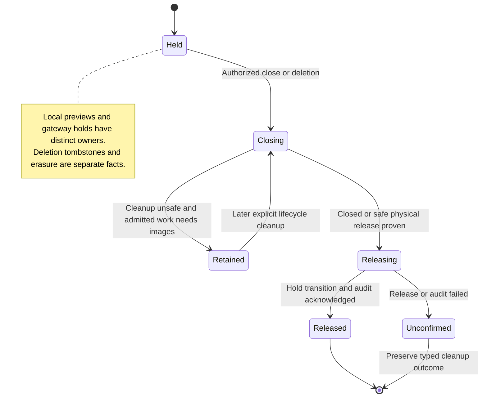

# Close or delete a conversation and release its uploaded images

Attachment close ends active and waiting work; turn Stop does not release image holds. The gateway releases uploaded images on close when cleanup establishes that no unsettled invocation still needs them. A turn cancellation alone leaves the attachment and holds available for later work. Delete also blocks further commands, disposes of the provider session where supported, and erases Nessa-owned history and summaries.

Closing a tab normally just removes the view. Its automatic-close exception requires a proven-empty idle conversation; ordinary prepared sessions do not qualify. Deletion can be confirmed while erasure remains unfinished. Provider cleanup, local erasure and saved audit evidence are separate results.

## Further reading

[Source](../../../../../src/conversation/adapters/store/slice.ts) · [Related source](../../../../../crates/nessa-server/src/conversation/application/service.rs) · [Related tests](../../../../../crates/nessa-attachments/tests/application.rs)

## Model coverage

The shared model on [gateway-conversation](../conversation.md) owns this journey's modeled slice. Tombstone-before-cleanup and audit-before-local erasure only; independent ticket withdrawal, multi-hold cleanup aggregation and audit failure ordering remain excluded. This is scoped design evidence, not whole-journey or implementation verification. The existing source checkpoint is retained.
