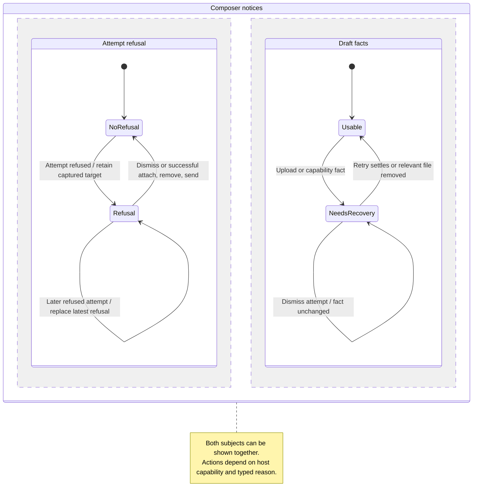

# Understand an attachment refusal and choose a useful recovery

A refusal explains whether the attachment could not be read, uploaded, normalized or included in the message. Check the stage before choosing recovery: reselect an unreadable native file, retry a failed upload, or choose a supported image format.

A file path does not supply bytes, and a successful local preview does not prove agent support. Pending work is different from a failed attempt. Removing a tile can clear a local refusal without releasing an upload already held by the gateway.

## Further reading

[Source](../../../../../src/panel/application/attachment-notice.ts) · [Related source](../../../../../src/panel/ui/attachment-notices.tsx) · [Related tests](../../../../../src/panel/application/attachment-notice.test.ts)

## Bounded rule model

Owns independent per-conversation attempt refusals and persistent draft facts. Dismiss/successful attach/remove/accepted send answer the target attempt; refused send does not. Restoring identical draft files cannot resurrect an answered attempt, and old provider/store callbacks cannot add a notice after replacement. Upload retry effects, typed advice, resource cleanup and all UI layout remain excluded. Two open conversations and one immutable original resource-store identity bound this model. This finite abstraction checks safety only. It does not execute or verify the implementation, promise eventual completion, or qualify external effects. Existing source checkpoints and historical test receipts retain their earlier scope. The scoped model review inspected `src/panel/ui/use-file-attachments.ts`, `src/panel/application/attachment-notice.ts`, `src/panel/ui/attachment-notices.tsx`, `src/panel/ui/use-file-attachments.test.ts`.
