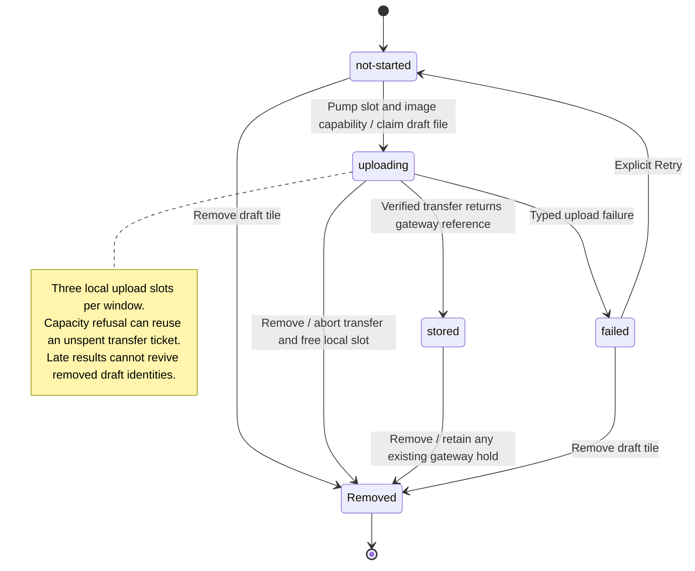

# Upload an image and retry a failed upload

Adding an image starts a transfer for the captured conversation. Nessa keeps the local original for preview and uses the gateway's returned reference for sending.

Retry starts a new upload attempt after a failure. Removing the tile aborts its transfer and frees the local slot. Gateway transfer tickets are separate from native file-read tickets: capacity refusal leaves the transfer ticket usable, while other transfer endings spend it. A slow transfer has its own three-minute deadline.

## Further reading

[Source](../../../../../src/panel/ui/use-attachment-uploads.ts) · [Related source](../../../../../src/panel/application/upload-image.ts) · [Related tests](../../../../../src/panel/application/upload-image.test.ts)

## Bounded rule model

Owns a single placement's captured conversation, hash-before-stage and removal refusal before staging. Active-tab changes cannot retarget this upload. Gateway ticket, normalization, hold confirmation, retries and queue bounds are excluded from this local operation model. This finite abstraction checks safety only. It does not execute or verify the implementation, promise eventual completion, or qualify external effects. Existing source checkpoints and historical test receipts retain their earlier scope. The scoped model review inspected `src/panel/application/upload-image.ts`, `src/panel/ui/use-attachment-uploads.ts`.
