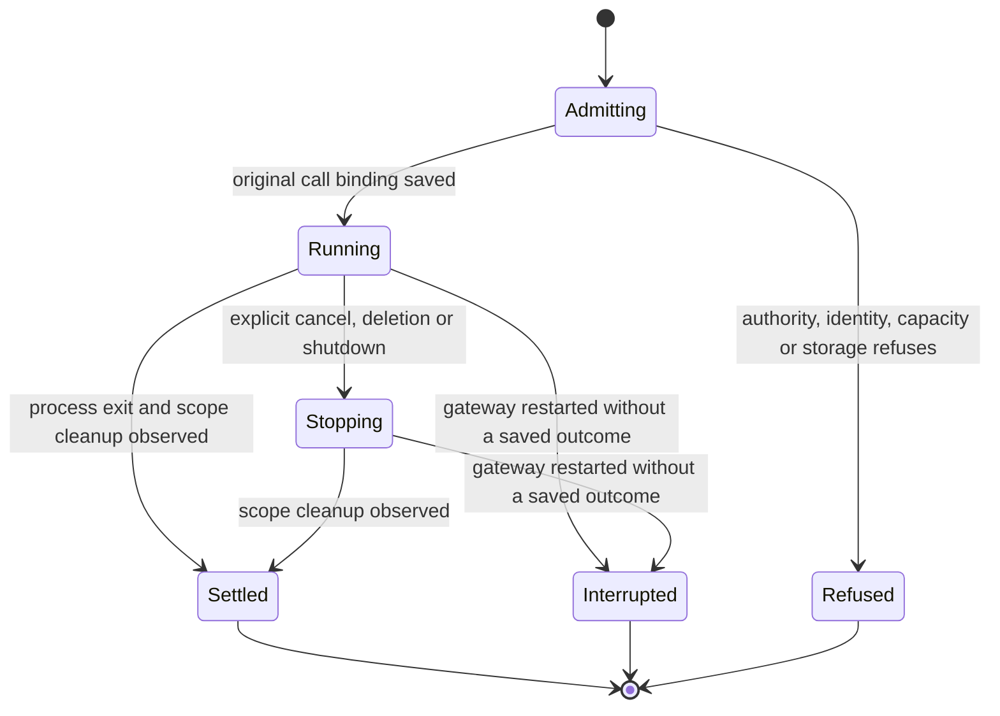
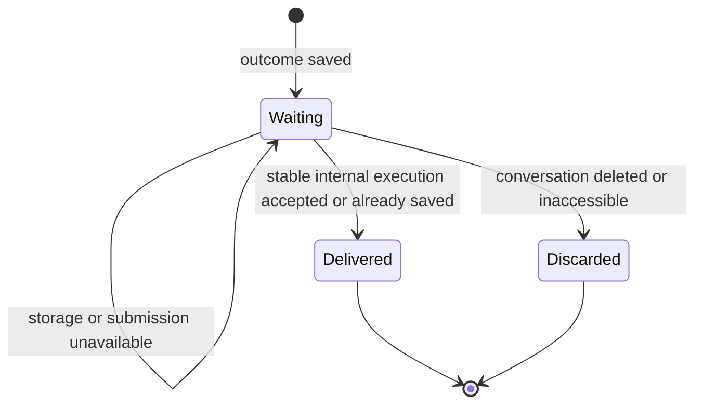

# Background tasks

An agent can start a local shell command and continue without waiting for it.
The existing tool waterfall keeps that call running until the command settles.
Completion supplies the actual outcome to the same conversation as internal model
input. The agent's reply is visible; the internal input creates no user bubble.

Normal shell calls remain available. Background tasks currently require a local
workspace. A remote conversation is refused before any command starts.

## Running beyond an agent turn

The gateway binds the task to the calling conversation, execution and native tool
call before handing execution to Shepherd. A retry with the same task identity
and command returns the original record. It cannot move the task to a later tool
row. Concurrent native calls that cannot be distinguished are refused before
execution.

Shepherd owns the command scope independently of the provider. Ending the turn
or parking the provider does not cancel the task. Explicit cancellation, gateway
shutdown and conversation deletion stop the owned scope. Cancellation intent,
physical exit and verified cleanup remain separate evidence. An uncertain cleanup
cannot become a successful shutdown or deletion.

Each result retains a bounded output tail. The continuation can contain less than
the retained result when the conversation's input limit is smaller; it says when
that happened and the status tool exposes the retained result. Completed records
remain until their conversation is deleted; transition audit survives that deletion, including the original command, workspace,
calling execution and initiator. If a stop audit fails, cleanup still reaches all
live owners and the supervisor, while the operation reports the audit failure.
The first stop intent remains with its owner for persistence retry.

## Returning the result to the model

The saved outcome precedes the internal continuation. Its stable execution ID
lets delivery recover a lost acknowledgement without running the command or
submitting the result again. A busy conversation queues the continuation; an idle
parked conversation reopens its provider session. Current access is checked using
the original caller. Internal input does not consume held user notes or app context.

The original waterfall row reads the persisted task outcome. Native MCP completion
only means the start request returned; it does not settle the background command.
The client keeps this row running independently of the calling turn's end.

## An interrupted gateway

A nonterminal record found at startup becomes interrupted with unknown cleanup.
Its command is not rerun, and no exit status or process cleanup is invented.
Before indexed recovery, the store streams all current records and checks that
their task, conversation, native call, revision and capacity facts agree with the
indexed row and original admission audit. Contradictory records prevent opening;
they are not repaired or silently skipped.
The task's identity, command and originating conversation remain available, but
this implementation cannot adopt a surviving process after host loss.

Running work, undelivered outcomes and unknown cleanup consume admission capacity:
32 tasks globally and four per conversation. Unknown cleanup also blocks deletion
from claiming that all resources were released. Automatic reconciliation of that
uncertainty is outside this implementation; it requires operator investigation.

## Verification scope

The new orchestration tests cover original-call binding, retries, busy and parked
providers, ambiguous admission, cancellation before admission, deletion, orderly
shutdown and interrupted restart. The conversation stress step uses a real
Shepherd command with a scripted harness through the production MCP relay and
checks the existing waterfall and internal continuation in Chromium and WebKit.
Native remote execution and process adoption after a gateway crash are excluded.
