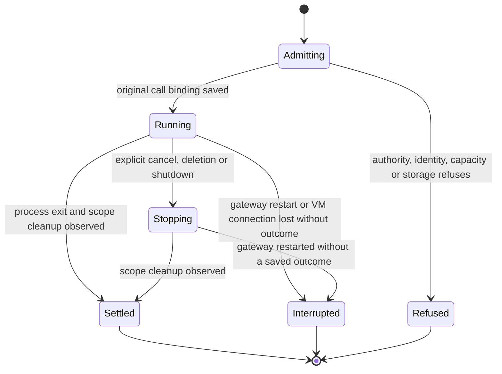
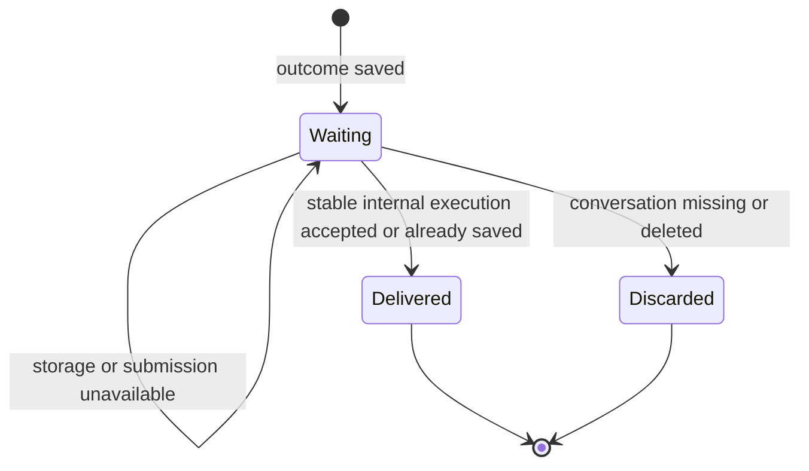

# Background tasks

An agent can start a shell command in its local workspace or cloud VM and continue without waiting for it.
The existing tool waterfall keeps that call running until the command settles.
Completion supplies the actual outcome to the same conversation as internal model
input. The agent's reply is visible; the internal input creates no user bubble.

Normal shell calls remain available. Local background commands run on the
gateway. Cloud commands run in the thread's existing VM. SSH-host and paired
computer conversations are refused before any background command starts.

## Running beyond an agent turn

The gateway binds the task to the calling conversation, execution and native tool
call before handing execution to Shepherd. A retry with the same task identity
and command returns the original record. It cannot move the task to a later tool
row. Concurrent native calls that cannot be distinguished are refused before
execution. The representation adapter accepts Claude's direct argument object
and Codex's MCP envelope. An envelope must name the same server and tool, and
both forms pass the same command and identity validation before comparison.

Shepherd owns the command scope independently of the provider. Ending the turn
does not cancel the task. A running task keeps a cloud conversation from idle
parking. In the VM, a separate SSH session runs the gateway's verified installed
`background-run` helper; its stream retains the workspace's `InUse` token, so a
direct rest also leaves the VM running. The gateway opens only the existing VM,
with provisioning disabled. The workspace reported by its lease and the
conversation's immutable placement identify where the saved task ran.

The helper uses the same bounded Shepherd runner as local execution. Its cleared
account environment contains no forwarded agent logins. A stop byte or stdin EOF
cancels the scope, and the helper waits for cleanup before sending its terminal
record. Its stdin descriptor is nonblocking and supports a pipe or socket, so
an unfinished input read does not hold runtime shutdown open after command exit.
Output uses the same readiness adapter, so shared stdin/stdout socket flags and
a full send buffer do not discard part of the terminal record.
The helper also drains its supervisor before leaving. The gateway validates that record and bounds the bytes read. A lost SSH
stream without a valid record settles interrupted with cleanup unconfirmed.
Terminal output travels with the final record; live output updates are not
published by this background-task API. Explicit cancellation, gateway
shutdown and conversation deletion stop the owned scope. Cancellation intent,
physical exit and verified cleanup remain separate evidence. An uncertain cleanup
cannot become a successful shutdown or deletion. The existing service retains a
failed owner for joining; unconfirmed cleanup can therefore keep a cloud thread
from idle rest. Automatic reconciliation of that uncertainty remains outside
this change, as it is for local tasks.

Each result retains a bounded output tail. The continuation can contain less than
the retained result when the conversation's input limit is smaller; it says when
that happened and the status tool exposes the retained result. Completed records
remain until their conversation is deleted; transition audit survives that deletion, including the original command, workspace,
calling execution and initiator. If a stop audit fails, cleanup still reaches all
live owners and the supervisor, while the operation reports the audit failure.
The first stop intent remains with its owner for persistence retry.

## Returning the result to the model

The saved outcome precedes the internal continuation. Its stable execution ID
lets delivery recover a lost acknowledgement without running the command or
submitting the result again. A busy conversation queues the continuation; an idle
parked conversation reopens its provider session. Current access is checked using
the original caller. Internal input does not consume held user notes or app context.

Once deletion has saved its tombstone, it withdraws pending continuation delivery
before joining task cleanup. This lets cleanup finish even when an export is
waiting for exclusive service admission. Withdrawal is separate from the first
process-stop cause. Discarded means delivery will not be retried; it does not
claim a concurrent submission was never accepted. Gateway retirement leaves
undelivered outcomes waiting for recovery.

The original waterfall row reads the persisted task outcome. Native MCP completion
only means the start request returned; it does not settle the background command.
The client keeps this row running independently of the calling turn's end.

## An interrupted gateway

A nonterminal record found at startup becomes interrupted with unknown cleanup.
Its command is not rerun, and no exit status or process cleanup is invented.
Before indexed recovery, the store streams all current records and checks that
their task, conversation, native call, revision and capacity facts agree with the
indexed row and original admission audit. Contradictory records prevent opening;
they are not repaired or silently skipped.
The task's identity, command and originating conversation remain available, but
this implementation cannot adopt a surviving process after host loss.

Running work, undelivered outcomes and unknown cleanup consume admission capacity:
32 tasks globally and four per conversation. Unknown cleanup also blocks deletion
from claiming that all resources were released. Automatic reconciliation of that
uncertainty is outside this implementation; it requires operator investigation.

## Verification scope

The new orchestration tests cover original-call binding, retries, busy and parked
providers, ambiguous admission, cancellation before admission, deletion, orderly
shutdown, deletion with queued export, and interrupted restart. The conversation stress step uses a real
Shepherd command with a scripted harness through the production MCP relay and
checks the existing waterfall and internal continuation in Chromium and WebKit.
The fake VM stress regression exercises repeated idle sweeps while a command
runs, rest after completion, transport interruption settlement, and restart
without replay. Stream tests run real local Shepherd processes to check EOF
cleanup, cancellation ordering, timeout, output bounds, and rejected records.
The workspace regression checks that a background stream retains `InUse` after
its runtime is dropped. A real CLI pipe test checks the helper and cleared secret
environment. No paid VM is provisioned by these checks. Real Boat connectivity,
provider-owned shells outside this API, live output publication, and process
adoption after a gateway crash are excluded.

## Bounded rule model

Owns one admitted task's first stop, immutable terminal outcome, interrupted cleanup uncertainty and one-way continuation disposition. Process execution, capacity admission, persistence CAS and delivery deduplication remain separate unmodeled boundaries. This finite abstraction checks safety only. It does not execute or verify the implementation, promise eventual completion, or qualify external effects. Existing source checkpoints and historical test receipts retain their earlier scope. The scoped model review inspected `crates/nessa-server/src/conversation/domain/background_task/lifecycle.rs`.

## Source review checkpoint

Reviewed source `9f10c41087f6602abae76168efd312e8574a4d6c` against the prior checkpoint. This review traced
admission, task binding, settlement/recovery, VM dispatch, descriptor I/O,
workspace ownership and their regressions. The unrelated transcript additions
since that checkpoint do not change background tool-row identity. The existing
bounded-rule model and its historical `modelCheck` receipt were not refreshed
or rerun; VM transport and physical cleanup remain outside its stated scope.
The Markdown references and diagram-detail targets were checked; chart rendering
was not inspected in a Nessa Docs renderer.
