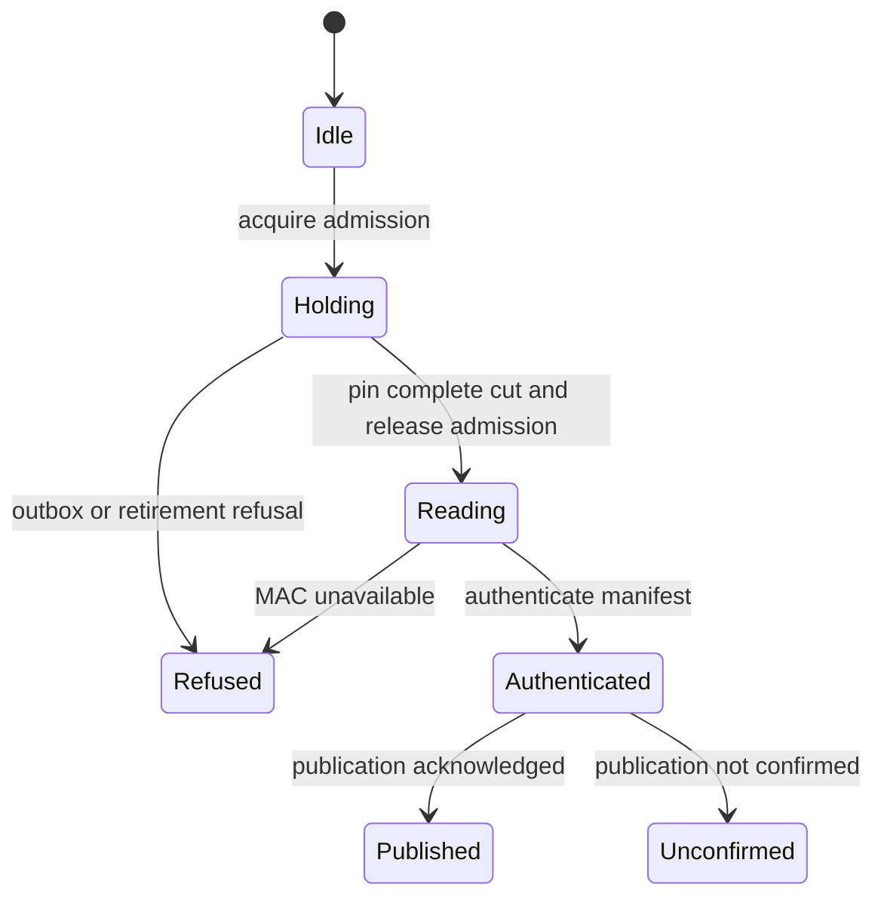

# Export a consistent backup cut

A backup joins admitted mutations long enough to pin the participating stores. It requires complete device and environment outboxes, captures deletion fences, then releases admission before reading the remaining pinned records, authenticating the manifest and publishing the bundle.

An unavailable ordinary store can be listed as skipped. An incomplete required outbox stops the export. Publication failure does not establish that no bytes reached the destination. Secret redaction and deferred active conversations remain part of the export format.

## Bounded rule model

One export and two abstract store classes are modeled: ordinary records and required outboxes. The rules separate a pinned consistent cut, released mutation admission, authenticated bytes and publication acknowledgement.

The configured safety rules are `AckRequiresCompleteCut`, `ReadingReleasesAdmission`. TLC explores the authored abstraction; it does not execute or prove the implementation.

| Model action | Source behavior abstracted |
| --- | --- |
| `Hold` | Acquire mutation admission after checking the writer inventory. |
| `Pin` | Pin each store and require complete outbox rows while admission is held. |
| `RefusePin` | Refuse an incomplete outbox or retiring gateway and release admission. |
| `Read` | Release admission before reading the remaining ordinary pinned records. |
| `Seal` | Authenticate the manifest constructed from the pinned cut. |
| `RefuseMac` | Stop publication when manifest authentication fails. |
| `Publish` | Publish the authenticated cut and acknowledge the result. |
| `PublishUnconfirmed` | Preserve uncertainty when publication does not acknowledge. |

## Verification limits

The model omits per-store serialization, secret detection, MAC cryptography, file sizes, deletion-fence reconciliation, concurrent exporters and recovery of partially written bundles. It makes no eventual-publication or power-loss guarantee. The cited code and regression sources were inspected at the page checkpoint; their product test suites were not run in this modeling pass.

## Further reading

[export.rs](../../../../crates/nessa-backup/src/application/export.rs) · [export.rs](../../../../crates/nessa-server/tests/backup/export.rs) · [export-cut.md](../../../../docs/design/export-cut.md)
