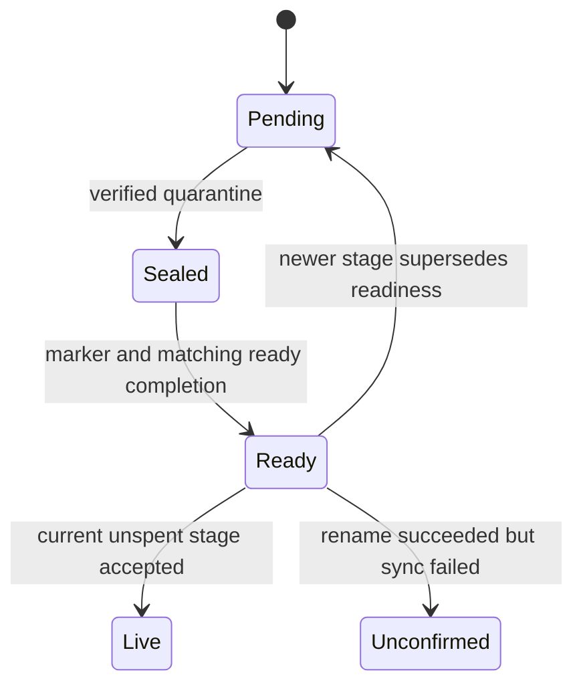

# Verify, quarantine and accept a backup

The standalone verifier checks supplied bundle bytes with an explicitly trusted key. Offline planning reports missing prerequisites; it cannot activate a gateway. Restore is a different operation: policy admission and its audit precede verification, quarantine staging, sealing and a correlated ready completion.

Acceptance checks the current journal, stage identity, receipts and empty live destination before promotion. A marker or historical seal alone is insufficient. A successful rename can make the destination live even when its later directory sync fails. Deferred conversation fetch has its own exact stream fingerprint and publication identity.

## Bounded rule model

Two stage generations and two journal digests explore superseded receipts, changed bytes and spent readiness. Completed receipts remain independently selectable after a later stage replaces them; acceptance checks the selected receipt rather than constructing matching proof from the current state. Acceptance records the identity actually used. Confirmed durability remains separate from a tree already made live.

The configured safety rules are `AcceptanceHasCurrentProof`, `DurabilityRequiresPublication`. TLC explores the authored abstraction; it does not execute or prove the implementation.

| Model action | Source behavior abstracted |
| --- | --- |
| `Seal` | Verify and seal the quarantined files and journal. |
| `Marker` | Publish the staging readiness marker for this generation. |
| `Ready` | Acknowledge ready completion with the matching stage and journal identity. |
| `ReplaceStage` | A newer stage supersedes prior readiness even when bytes are unchanged. |
| `ChangeJournal` | Observe a changed journal that cannot reuse its previous sealed identity. |
| `RetireStage` | Spend a pending or ready stage so a later receipt cannot revive it. |
| `Accept` | Promote only the current unspent verified stage onto an empty live destination. |
| `AcceptUnsynced` | Retain live ownership when rename succeeds but directory sync is unconfirmed. |

## Verification limits

The abstraction assumes successful policy/audit admission before staging. It omits trusted-key recovery, host identity fencing, omission acceptance, file-handle containment, deferred fetch streaming and OS-specific quarantine protection. The offline plan remains informational even though a separate quarantine use case now exists. The cited code and regression sources were inspected at the page checkpoint; their product test suites were not run in this modeling pass.

## Further reading

[restore.rs](../../../../crates/nessa-server/src/backup/application/restore.rs) · [restore.rs](../../../../crates/nessa-server/tests/backup/restore.rs) · [quarantined-restore.md](../../../../docs/design/quarantined-restore.md)
