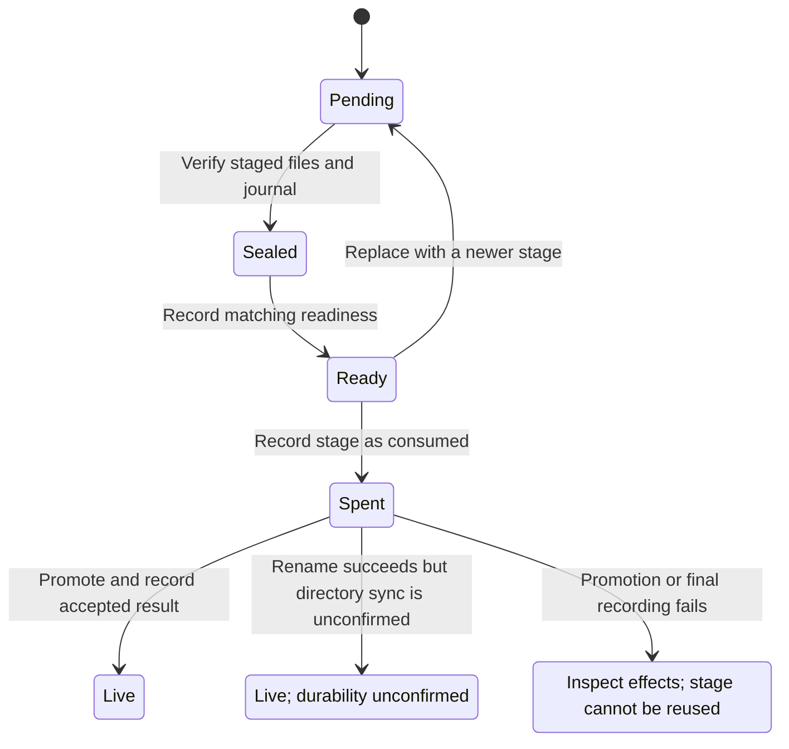

# Restore a backup without guessing whether it became live

Restoring a backup first prepares a separate folder, called the **quarantine**.
The gateway checks that folder before accepting it into the **live destination**,
the location it will use. Checking a backup, preparing it and making it live are
separate operations. The standalone verifier and offline planner cannot activate
a gateway.

For example, a backup can pass verification but still be refused because the
live destination is occupied. A later acceptance error can also occur after files
have become live. An error does not establish that nothing changed.

## What acceptance checks

The restore owner admits and audits the request before staging files. It records
a seal for the exact staged files and journal. The journal describes what was
staged; the seal and ready completion identify this particular staging generation.
A readiness marker alone, or proof retained from an older stage, is insufficient.

Acceptance checks the current journal, staging identity, required attestations
and empty live destination. It then records that this stage is **spent** before
attempting promotion. Once that record is stored, a later failure requires a
fresh stage to retry, even if the rename failed and the old folder remains.

## If acceptance fails

After a successful rename, the files can already be live even if flushing the
directory to storage was not confirmed. A later audit failure can return an error
after publication too. A source-retirement or publication-restriction problem can
return `Retained`; this does not mean the live destination stayed empty.

Do not treat these outcomes as rollback or blindly reuse the old ready stage.
Inspect the recorded stage and live destination before deciding what to do next.
This page does not establish a recovery command that is safe for every partial
publication. The [restore design](../../../design/quarantined-restore.md) owns the
underlying conditions; a source review is still needed for an operator-specific
recovery procedure. A fresh stage does not override the empty-destination check.

The diagram focuses on acceptance and its irreversible boundary. Earlier policy,
verification and readiness refusals are described above; deferred conversation
fetch has a separate stream fingerprint and publication identity.

## Bounded rule model

Two stage generations and two journal digests explore superseded receipts, changed bytes and spent readiness. Completed receipts remain independently selectable after a later stage replaces them; acceptance checks the selected receipt rather than constructing matching proof from the current state. Acceptance records the identity actually used. Confirmed durability remains separate from a tree already made live. The model
abstracts acceptance and stage retirement; it does not enumerate the diagram's
individual promotion, final-audit or source-retirement failure outcomes.

The configured safety rules are `AcceptanceHasCurrentProof`, `DurabilityRequiresPublication`. TLC explores the authored abstraction; it does not execute or prove the implementation.

| Model action     | Source behavior abstracted                                                      |
| ---------------- | ------------------------------------------------------------------------------- |
| `Seal`           | Verify and seal the quarantined files and journal.                              |
| `Marker`         | Publish the staging readiness marker for this generation.                       |
| `Ready`          | Acknowledge ready completion with the matching stage and journal identity.      |
| `ReplaceStage`   | A newer stage supersedes prior readiness even when bytes are unchanged.         |
| `ChangeJournal`  | Observe a changed journal that cannot reuse its previous sealed identity.       |
| `RetireStage`    | Spend a pending or ready stage so a later receipt cannot revive it.             |
| `Accept`         | Promote only the current unspent verified stage onto an empty live destination. |
| `AcceptUnsynced` | Retain live ownership when rename succeeds but directory sync is unconfirmed.   |

## Verification limits

The abstraction assumes successful policy/audit admission before staging. It omits trusted-key recovery, host identity fencing, omission acceptance, file-handle containment, deferred fetch streaming and OS-specific quarantine protection. The offline plan remains informational. A gateway whose namespace points at a tree that is not an accepted live restore refuses to listen; `conversation.read` fetches one deferred conversation and refuses when that source is gone. Those gateway steps are outside this model. The cited code and regression sources were inspected at the page checkpoint; their product test suites were not run in this modeling pass.

## Further reading

[restore.rs](../../../../crates/nessa-server/src/backup/application/restore.rs) · [gateway_restore.rs](../../../../crates/nessa-server/src/backup/application/gateway_restore.rs) · [restore_command.rs](../../../../crates/nessa-server/src/composition/restore_command.rs) · [restore.rs](../../../../crates/nessa-server/tests/backup/restore.rs) · [gateway_restore.rs](../../../../crates/nessa-server/tests/backup/gateway_restore.rs) · [quarantined-restore.md](../../../../docs/design/quarantined-restore.md)
