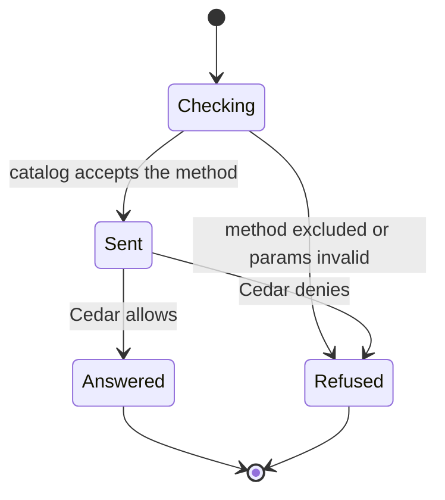

# Call a gateway method from the CLI or MCP

`nessa call` and `nessa mcp` send a method the app can already send. They do not
implement the method again. The gateway handler that answers the app answers them,
and Cedar is the only permission check.

The method list is generated from `protocol/product/manifest.json`. A method in
`protocol/product/surface-exclusions.json` is left out, and each exclusion has a
written reason: the handshake, upload byte pieces, and subscriptions that stream
events after their acknowledgement. `pnpm protocol:check` fails if a new manifest
method is in neither place.

## One call

`nessa call conversation.list --params '{}'` reads `auth/surfaces/nessa-cli.token`
and opens `/session`. `nessa mcp` reads `auth/surfaces/nessa-mcp.token` and serves
one MCP tool per exposed method. Both go through `invoke`, which checks the
params against the method's schema and then sends the method on that socket.

`server --provision-local` creates the MCP credential when the file is absent.
Without an explicit `--grants`, that credential holds `server.read`,
`conversation.read`, and `conversation.write`. It does not hold
`credential.manage`. The credential's principal is who Cedar sees. The client
name on the handshake does not grant anything.

## The catalog accepts the call

Checking happens in this process, before a socket write, when the method is
unknown, excluded, or the params do not match the schema in
`protocol/product/v1.json`. Those stops use `unknown_method` or
`invalid_request`. Nothing is sent, so the handler does not run.

A method the catalog accepts is sent as it was given. This step does not look
at the caller's grants.

## Cedar decides on the gateway

The signed-in session hits the same admission as the app. The manifest names
the grant, and Cedar permits it only when the credential holds that grant on
this gateway and the membership is active. An allow continues into the method's
existing handler. The handler's JSON is the successful result.

## A missing grant is the gateway's code

A deny comes back as the gateway's `forbidden` (or another code the handler
itself returns). `nessa call` prints `{"ok":false,"code":"..."}` and exits
nonzero. An MCP tool call returns that same JSON as its text and marks the tool
result an error. The process keeps serving. The refusal text from the gateway
is not copied out: the code is the contract.

Each tool's input schema is the method's parameter object, with `type` set to
`object` on that schema. A call waits as long as the longest handler can still
be working, including an agent install's archive transfer. If the answer does
not arrive in that time, or the reply cannot be tied to the request, the
connection is closed. The next call signs in again, so it cannot read the late
reply. A `vault.changePassphrase` call that was sent and then lost is not that
ordinary failure: both surfaces report `vault_change_not_confirmed`, because
the change may already have taken effect.

What this page does not cover: subscriptions stay excluded because one reply
would drop their events, and upload or resource bytes still travel on their HTTP
routes. In-app Claude and Codex harnesses are not yet launched with `nessa mcp`.
