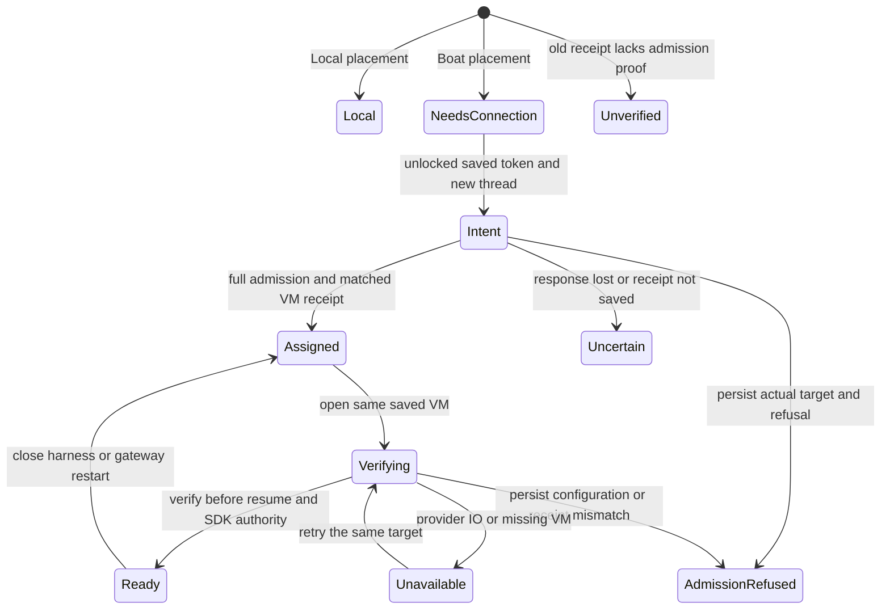
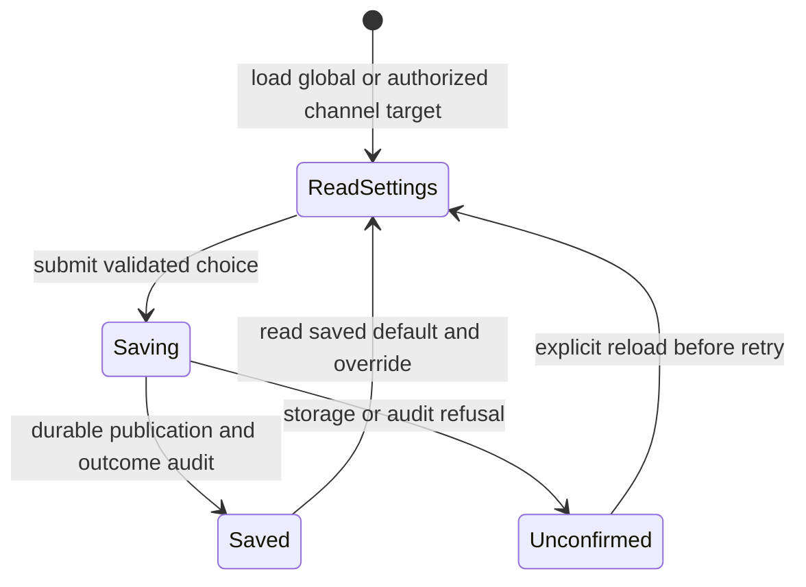
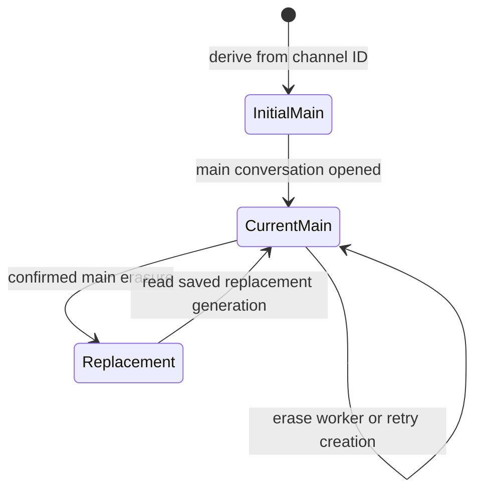

# Channel workspaces

This page reviews the alpha placement, allocation and main-chat lifecycle. It
does not claim deployment, provider availability or completion of cloud wake,
capacity scheduling, provider OAuth or live migration. Local remains the default
for both channel choices. The main agent runs on messages and worker reports.

A durable receipt holds the thread, original image, VM and immutable provider
environment/version identity. Complete admission permits only the explicit
agent-credential posture, with the owner's default profile and no additional
GitHub, general/sandbox credentials, contents, secret files or repository/setup
injection. Unknown credential/access configuration refuses. Current settings are
checked at creation and reconnection, with a concrete VM receipt check before
any workspace SDK, harness, SSH or MCP authority.

Creation checks again after Boat's name-based create; the provider does not offer
a version selector, so provider/privileged mutation during that operation remains
a trust boundary. A mismatch durably records Refused with the actual target and
bounded expected/observed evidence. Only an acknowledged pending new allocation
requests rollback. Reconnect, ready/idempotent replay and unrecognized creation
acknowledgements retain the target and existing data. Durably Refused
and old Unverified receipts cannot reconnect, upgrade themselves or allocate a
replacement. Refusal storage, audit and cleanup failures are reported separately;
if persistence fails, no durable refusal or confirmed deletion is claimed.
Future openings must still verify the same saved identity; they never select a
new target.
A create intent is written first; uncertainty is retained rather than creating a
second resource. An observer disappearing does not cancel the allocation task's
receipt publication. Closing or deleting chat history preserves workspace files
and VM identity. Users manage VM stop/delete in Boat. No automatic stop is the
initial Nessa default; alpha has no idle parking or active TTL renewal.

## VM lifetime settings

Settings holds a Nessa default. A saved channel can inherit that default, stop
after a selected duration, or request no automatic stop. Finite durations include
active work. The selected value is sent explicitly to Boat on creation and
archived resume; a running VM keeps its existing deadline. Provider account
restrictions may stop a VM sooner, and an unlimited VM can remain billable.
Before workspace authority is granted, a finite create or archived resume
must return a positive provider TTL no longer than the selected limit. A missing,
null, zero or longer TTL refuses while retaining the actual VM target. Reopening an already
active VM does not compare its original deadline with a newly edited setting.

Ordinary preferences live in the gateway's existing `config.json`, separate
from the encrypted Boat token. Missing channel overrides inherit; explicit
null requests no automatic stop. The default and override are read together for
the requested scope before allocation. The typed inheritance rule applies any
present choices from broadest to most specific; the current channel model supplies
only the Nessa default and one channel choice. A future parent level must be
resolved by the feature that owns its identity. A settings snapshot for another scope
refuses before provider effects. Channel membership is resolved by the shared
channel store; a failed or mismatched lookup refuses rather than falling back
to the global default. Channel edits require Cedar authorization.

The configuration adapter owns each accepted save through caller loss using
the shared configuration lock and atomic publication. Requested and outcome
audit records retain the target, caller, before/requested choice and observed
publication result. Failed audit or uncertain publication receives no success
acknowledgement; the editor reloads before another attempt.

The placement contract owns one retention bound shared by the operational
catalogue on every platform and the Unix connection cache. At capacity, only
unborrowed environments with no lease or command owner can be evicted; otherwise
a new opening is refused. Eviction does not delete the VM assignment.

Boat connects the user's existing provider subscription. Nessa stores only the
infrastructure connection in its encrypted vault. A matching prebuilt worker
image is required. Shipping checks reject a release pin that does not cover the
compiled lease protocol; an incompatible source build refuses token-only setup
until a matching image is published. The local gateway stays reachable and its vault must be
unlocked to provision. The SDK prepares the attached workspace; existing SSH
leases own agent process framing, approvals, accounting and cleanup.

Approved local access uses existing MCP connections. A pinned SSH connection
forwards only the gateway's scoped relay socket; local executable paths and local
provider credentials are omitted from hosted configuration. Removing an MCP
connection applies to new openings. Existing sessions keep theirs until closed;
closing and reopening revokes the old grants and uses the new set. There is no automatic local-folder copy or
mount, and local Nessa GitHub sign-in is not copied into remote Git.

Explicit uploaded-file inputs are a separate delivery contract. Their durable
references stay in conversation history. The resolver bound to that conversation's
opening lease prepares a transient link in the selected Local or remote workspace;
the SDK verifies correlation before dispatch. Preparation spends the original
operation deadline, and required placement evidence remains owned after caller
cancellation. This does not authorize mounting local folders or forwarding local
provider credentials. The shared hosted configuration projection accepts only the
selected host's explicit scoped MCP relay, including for OpenCode.

The channel store journals replacement and removes the erased main's link in one
transaction. The retired conversation links the committed deletion and its real
initiator. Retrying erasure preserves the replacement; permanent conversation
tombstones remain intact. Channel navigation chooses the current main before a
newer worker, and its header displays Local or Boat.

Allocation and encrypted-vault tests are in `tests/workspaces`. Channel migrations
and replacement history are exercised against real SQLite. The opt-in real
provider workflow and its limits are described in
[workspace verification](../../../../scripts/workspaces/README.md). The existing
backup omission of channel-owned data is tracked in
[issue 1161](https://github.com/nessalabs/nessa-agent/issues/1161); allocation receipts
and environment audit files are included in the EnvironmentAudit inventory.

An untouched Claude native session is not persisted until its first prompt. SDK
attachment asks the provider with the saved ID and whether any invocation was
admitted. Claude opens a new native context only for an uninvoked history; the
existing context transition records its replacement. A history with admitted work
still requires successful resume. Missing used native history is refused with
its saved inputs and context retained. VM identity and workspace files do not
change when the untouched native context is replaced.

The empty-history exception does not classify a fresh native context created by
switching agents or changing a workspace after earlier work. That existing cold
context case remains conservatively refused if native resume fails; tracking
admission per context is [issue 1164](https://github.com/nessalabs/nessa-agent/issues/1164).

Receipt-save failure retains the returned VM target in independent recovery
audit evidence before rollback, and records rollback observation afterward.
Failed or panicking audit ports do not skip cleanup; an unconfirmed cleanup or
audit failure remains visible in the typed recovery error with its target.
An accepted allocation task owns these steps after caller loss. Boat receives
`NESSA_THREAD_ID` as a non-secret per-VM correlation marker before creation, so
provider-side inspection still links the VM to the durable intent if both local
stores are unavailable. No automatic replacement is authorized. Recovery audit
files use the existing private, timestamped EnvironmentAudit store and backup
inventory; their thread ID links the original conversation creation/lease actor.
