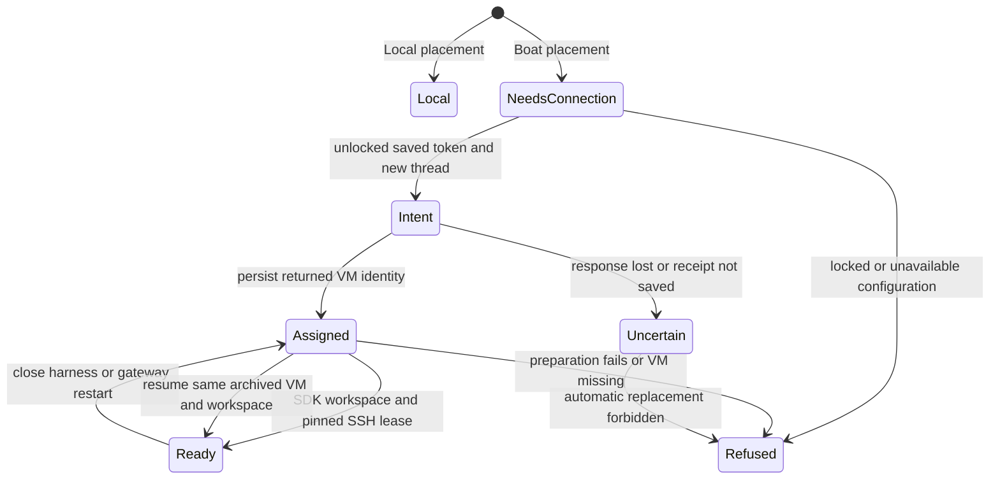
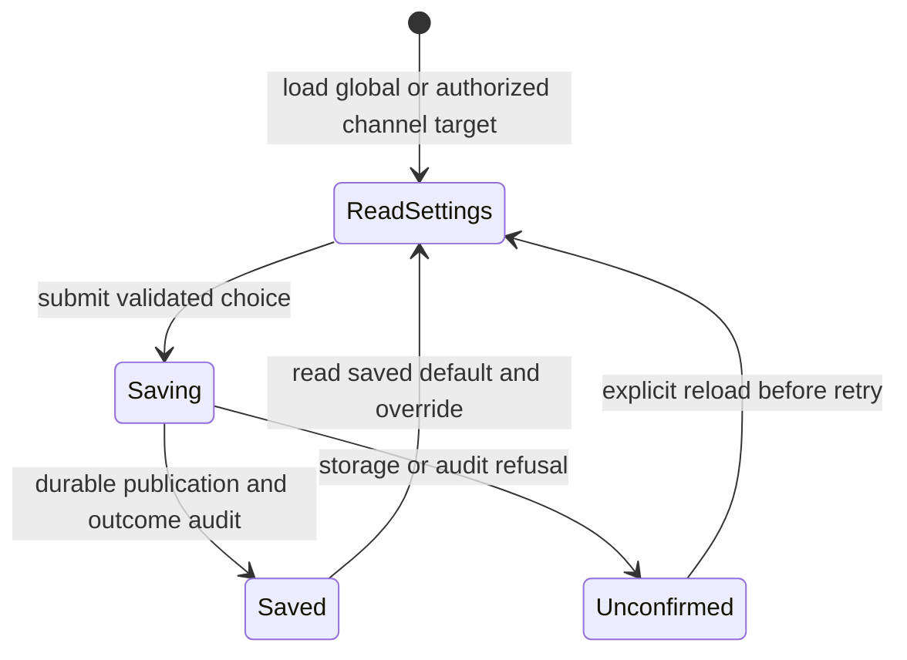
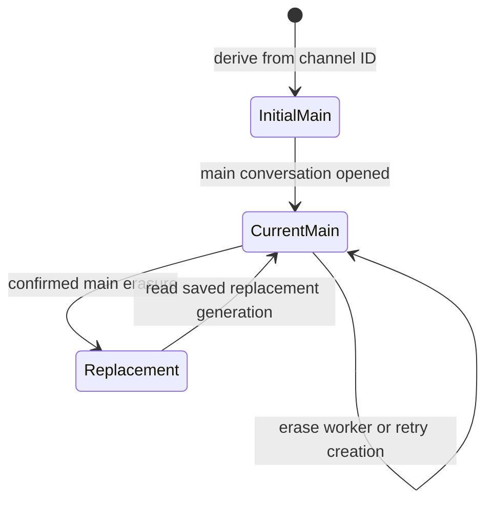

# Channel workspaces

The combined lifetime, input-delivery and matching-worker contract was reviewed
at the source checkpoint above. Actual Boat verification passed uploaded-file
delivery and preserved workspace files after archived resume; native phone
consumer compatibility and broad browser/performance results are reported
separately in the verification evidence.

This page reviews the alpha placement, allocation and main-chat lifecycle. It
does not claim deployment, provider availability or completion of cloud wake,
capacity scheduling, provider OAuth or live migration. Local remains the default
for both channel choices. The main agent runs on messages and worker reports.

A durable receipt holds the thread, original image, environment and VM identity.
A create intent is written first; uncertainty is retained rather than creating a
second resource. An observer disappearing does not cancel the allocation task's
receipt publication. Closing or deleting chat history preserves workspace files
and VM identity. Users manage VM stop/delete in Boat. Auto-stop is configurable,
with no automatic stop as the initial default. Alpha has no idle parking or
active TTL renewal.

## VM lifetime settings

Settings → Connections → Accounts holds the Nessa default. A saved channel's
settings can inherit that default, stop after a selected duration, or request no
automatic stop. Finite durations include active work. Changing the choice affects
new and archived/resumed VMs for both main agents and workers; a running VM keeps
its current deadline. Boat's account restrictions still apply. With no automatic
stop, compute can remain billable until the user stops it in Boat.

Ordinary preferences live in the gateway's existing `config.json`. A missing
channel override inherits, an explicit null disables automatic stop, and positive
seconds select a finite duration. The default and override are read together for
the requested channel before allocation. A snapshot for another channel is
refused. The shared channel store resolves thread membership; a read failure or
dangling channel refuses the opening rather than selecting a fallback. These
lookups also refuse a different returned channel before authorizing or allocating
the requested target. The gateway-wide override map uses the shared configuration
byte bound, rather than one owner's channel quota. These
preferences are independent of the encrypted Boat token and can be edited without
unlocking the credential vault.

The client captures the requested target once and uses it for both dispatch and
response binding. Non-enumerable or accessor properties cannot change the target
between those steps; inherited scope refuses before dispatch. The read/write
regressions in `boat-api.test.ts` exercise these cases with the actual outgoing
request, including valid channel responses.

The configuration adapter owns each accepted settings save, including after its
socket caller disappears. It uses the existing configuration lock and atomic
publication so other settings editors preserve each other's sections. Channel
edits require the channel owner's Cedar permission. Requested and outcome audit
records retain the target, caller, operation, before/requested choice and observed
publication result. A failed audit or uncertain publication receives no success
acknowledgement. The editor asks the user to reload before another attempt.

The settings save has this lifecycle; the lifetime values themselves are
immutable. The runtime section is included in the existing configuration backup
cut, with validated fields only. Runtime audit records join the existing
environment-audit inventory. This describes export, not automatic restoration of
channel-owned state, which remains tracked below.

The browser verifier `boat-runtime-settings.mjs` checks default/override/reset,
invalid requests, label geometry and keyboard focus in both engines and layouts.
The channel row keeps its settings action separate from decorative counts and
running status. Clicking a decoration still selects the row; the settings button
opens its dialog and returns focus when it closes. `shared-controls.mjs` checks
the row hit targets and label clearance. No separate lifecycle is introduced for
these simultaneous row facts.

Its shared check also runs in the conversation stress channel step. Allocation
tests cover settings propagation and scope substitution; real provider lifetime
receipts are part of the opt-in workspace workflow.

## Workspace connections and local access

The placement contract owns one retention bound shared by the operational
catalogue on every platform and the Unix connection cache. At capacity, only
unborrowed environments with no lease or command owner can be evicted; otherwise
a new opening is refused. Eviction does not delete the VM assignment.

Boat connects the user's existing provider subscription. Nessa stores only the
infrastructure connection in its encrypted vault. A matching prebuilt worker
image is required. Shipping checks reject a release pin that does not cover the
compiled lease protocol; an incompatible source build refuses token-only setup
until a matching image is published. The local gateway stays reachable and its vault must be
unlocked to provision. The SDK prepares the attached workspace; existing SSH
leases own agent process framing, approvals, accounting and cleanup.

Approved local access uses existing MCP connections. A pinned SSH connection
forwards only the gateway's scoped relay socket; local executable paths and local
provider credentials are omitted from hosted configuration. Removing an MCP
connection applies to new openings. Existing sessions keep theirs until closed;
closing and reopening revokes the old grants and uses the new set. There is no automatic local-folder copy or
mount, and local Nessa GitHub sign-in is not copied into remote Git.

Explicit uploaded-file inputs are a separate delivery contract. Their durable
references stay in conversation history. The resolver bound to that conversation's
opening lease prepares a transient link in the selected Local or remote workspace;
the SDK verifies correlation before dispatch. Preparation spends the original
operation deadline, and required placement evidence remains owned after caller
cancellation. This does not authorize mounting local folders or forwarding local
provider credentials. The shared hosted configuration projection accepts only the
selected host's explicit scoped MCP relay, including for OpenCode.

The channel store journals replacement and removes the erased main's link in one
transaction. The retired conversation links the committed deletion and its real
initiator. Retrying erasure preserves the replacement; permanent conversation
tombstones remain intact. Channel navigation chooses the current main before a
newer worker, and its header displays Local or Boat.

Allocation and encrypted-vault tests are in `tests/workspaces`. Channel migrations
and replacement history are exercised against real SQLite. The opt-in real
provider workflow and its limits are described in
[workspace verification](../../../../scripts/workspaces/README.md). The existing
backup omission of channel-owned data is tracked in
[issue 1161](https://github.com/nessalabs/nessa-agent/issues/1161); allocation receipts
and environment audit files are included in the EnvironmentAudit inventory.

An untouched Claude native session is not persisted until its first prompt. SDK
attachment asks the provider with the saved ID and whether any invocation was
admitted. Claude opens a new native context only for an uninvoked history; the
existing context transition records its replacement. A history with admitted work
still requires successful resume. Missing used native history is refused with
its saved inputs and context retained. VM identity and workspace files do not
change when the untouched native context is replaced.

The empty-history exception does not classify a fresh native context created by
switching agents or changing a workspace after earlier work. That existing cold
context case remains conservatively refused if native resume fails; tracking
admission per context is [issue 1164](https://github.com/nessalabs/nessa-agent/issues/1164).

Receipt-save failure retains the returned VM target in independent recovery
audit evidence before rollback, and records rollback observation afterward.
Failed or panicking audit ports do not skip cleanup; an unconfirmed cleanup or
audit failure remains visible in the typed recovery error with its target.
An accepted allocation task owns these steps after caller loss. Boat receives
`NESSA_THREAD_ID` as a non-secret per-VM correlation marker before creation, so
provider-side inspection still links the VM to the durable intent if both local
stores are unavailable. No automatic replacement is authorized. Recovery audit
files use the existing private, timestamped EnvironmentAudit store and backup
inventory; their thread ID links the original conversation creation/lease actor.
