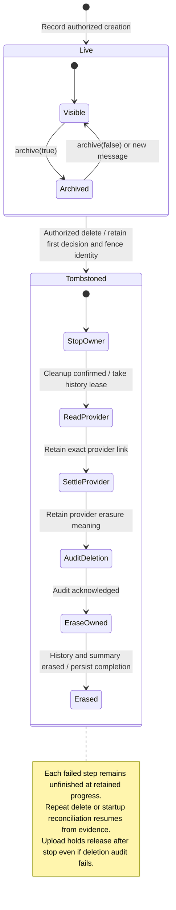
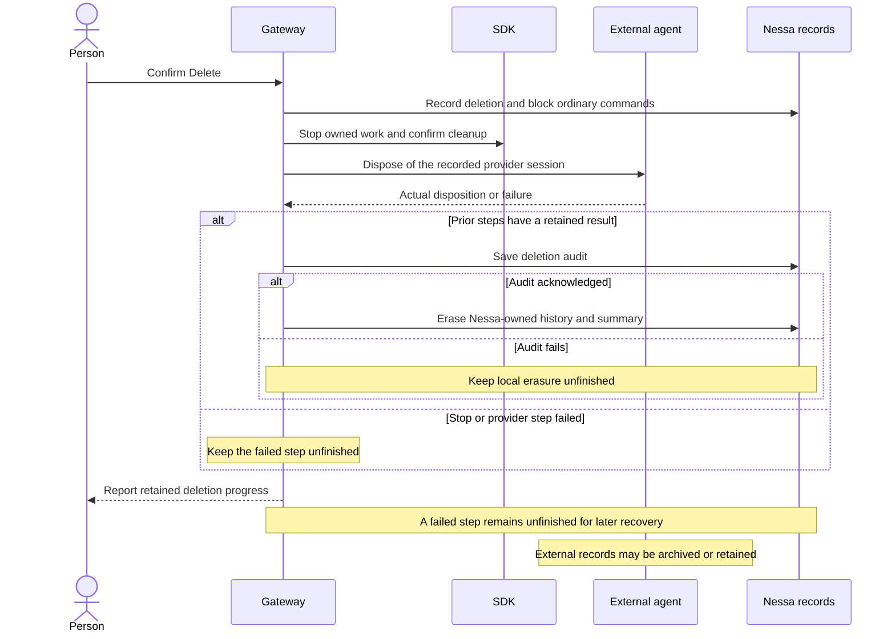
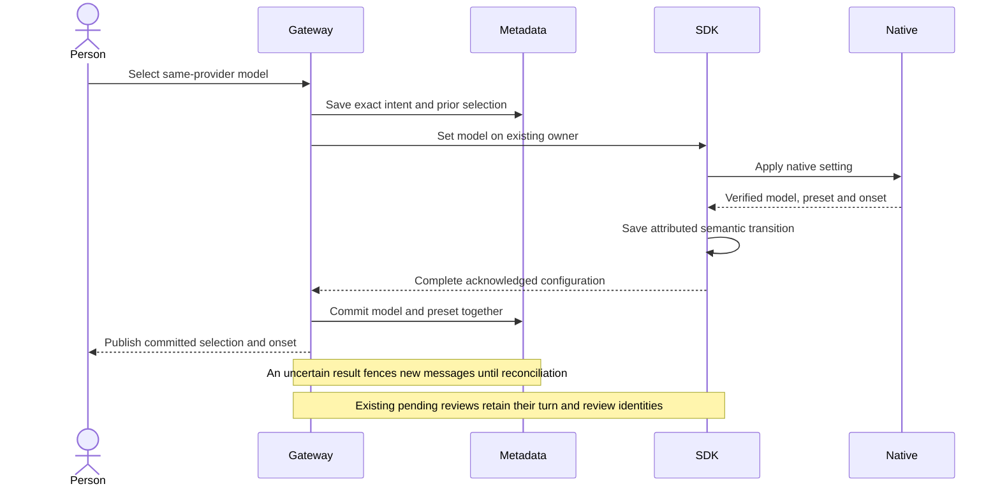

# Conversation identity and deletion

A conversation belongs to its original creator and organization. Archive changes whether it appears in lists while keeping its history and work.

Delete first records the decision and blocks ordinary commands under that identity. It then stops work, checks the provider's cleanup result and erases Nessa-owned data. Failed steps remain unfinished and can be resumed. The original decision stays attached to repeats; Nessa does not recreate the deleted identity.

## What external cleanup can mean

| Provider erasure evidence | Meaning |
| --- | --- |
| Deleted | Binding erases the provider-owned record. |
| Archived | Provider-owned record is retained as an archive. |
| Acknowledged | The provider accepted deletion; record disposition is not known. |
| NotListed | Delete was refused and a subsequent full list does not name it. |
| NotSupported / NoHandler | Provider retained its record; this path could not ask for erasure. |
| SessionUnknown | Leased local history does not establish the provider identity; do not claim no provider record. |

Nessa retains the reported provider result. Finishing local erasure does not change an archived or unknown external result into deleted.

## Deletion order

## Further reading

[Source](../../../../crates/nessa-server/src/conversation/application/service.rs) · [Related source](../../../../crates/nessa-server/src/conversation/domain/value_objects/conversation_deletion.rs) · [Related tests](../../../../crates/nessa-server/tests/conversation/deletion.rs)

## Live model selection

A same-provider model choice keeps the current native session and turn. The
provider acknowledges the application boundary: subsequent responses or the
next turn. The current turn's recorded model and permission decisions remain
historical facts.

The existing environment lease adapts a target factory to the same execution
place before the original lease fence wraps it. A remote target keeps its
already granted host connection and lease; it cannot fall back to a local
factory when workspace path text happens to match.

The conversation admission lock serializes model choices, permission presets
and new messages. `model_requests` keeps the original request, actor, prior
selection and observed result. The SDK's attributed `ModelChanged` record is
the native application evidence. Metadata commits the acknowledged model and
native approval preset together; fresh admission then uses that binding's limits
and configured output reservation. A saved submission keeps its complete
original request for retries, including the original reservation. Reopening and
detached reads recover the last confirmed model effect only by joining the SDK
fact to its Applied metadata request and the current committed model. A later
independent preset choice does not alter that historical model timing.

Recovery joins the exact actor, request, prior identity and acknowledged target
across both journals. It does not resend the model control. Without a matching
SDK fact, recovery retires the uncertain native generation and verifies the
committed prior configuration before releasing admission. Failed cleanup or
unreadable evidence leaves recovery required.

A pending selection has distinct publication and recovery admission. The
following table applies independently to mode and model requests: Open versus
LiveOnly, held versus free selection lock, and attached versus stopping versus
released owner cover all 24 combinations. Released means no live slot at read
entry; losing a captured owner during an await is refused separately.

Startup resumption is fresh admission under the same selection lock. A marked owed
turn remains owed while either model or preset evidence is pending, including an
opening used only to verify the prior model during recovery. The normal model
owner reconciles the retained intent before a later resumption can dispatch.
`startup_resumption_waits_for_pending_model_evidence` and
`startup_resumption_runs_after_model_evidence_settles` are prepared public
startup/normal-Open regressions. The actual before-probe admitted a successor
and dispatched it while model intent stayed Pending, and cleared the owed mark;
the normal-Open reconciliation counterpart passed. The common resumption owner
now checks both pending journals under its existing admission lock before any
successor is admitted.

| Selection lock | Owner | Open | LiveOnly |
| --- | --- | --- | --- |
| Held | Attached | Fresh guarded pending view; no recovery or opening | Same |
| Held | Stopping | Closed; no stale publication or new attachment | Same |
| Held | Released | Detached nonactionable pending view; no opening | Same |
| Free | Attached | Reconcile exact SDK evidence first; settle selection or return a fresh guarded pending view on failure | Pending view only; no recovery |
| Free | Stopping | Validate intent and retry that stopped owner's cleanup. While cleanup fails, refuse publication and retain intent without opening; after release, reconcile and open once | Closed; no cleanup |
| Free | Released | Reconcile pending request, then explicitly open the selected binding | Detached pending view; no opening |

If the lock is held before an intent becomes durable, wait for the lock and
follow the free row. A live owner that stops, disappears or changes during the
awaited title/access read cannot publish that captured view. Recovery does not
reuse a view captured before cleanup. `read_at` owns this ordering for both
controls; pending construction and final same-owner publication remain separate.

| Transition | Evidence |
| --- | --- |
| Durable preset intent admitted, native RPC held | `an_overlay_change_without_a_commit_is_delivered`: prior preset, Changing, unchanged SDK cursor; service notifies after durable admission and before dispatch |
| Original owner stops during pending title read | `a_pending_mode_view_rechecks_its_owner_after_the_title_wait`: no stale publication after retained stop or confirmed release |
| Unknown result and failed cleanup | `failed_session_retirement_keeps_mode_recovery_pending_without_a_second_open`: intent retained, no second open while blocked, explicit Open retries after cleanup is released |
| Known SDK acknowledgement and failed cleanup | `acknowledged_model_recovery_retries_the_stopped_owner` and `acknowledged_preset_recovery_retries_the_stopped_owner`: exact original fact settles without repeating native control |
| Queued input or PromptRequired steering from a distinct checked share-grant initiation admitted under model A, then model B requested | SDK refuses Busy before native effect while pending work remains. Drain all four A receipts, then select B; durable queue-admitted JSON retains A's name/modelId/context; `durable_queue_admission_keeps_the_admitted_model_after_selection_changes` |
| Completed A submission retried after selecting B with different limits and reservation | Saved complete execution request owns retry admission fields; same message/actor/operation recovers original delivery, changed message/actor/operation conflicts; `a_submission_retry_keeps_its_original_budget_after_a_model_change` |
| Confirmed model choice, then close/reopen, gateway restart or detached read | The existing live/detached publication read joins its already-read committed SDK model fact to its Applied metadata request and current committed model before restoring its effect; `a_confirmed_model_effect_survives_detached_reads_and_reopening` |
| Confirmed model choice followed by an independent permission preset | Retain the historical model effect while publishing the newly committed preset; `a_confirmed_model_effect_survives_detached_reads_and_reopening` |
| Durable model fact has no matching Applied metadata request, or its target is no longer the committed selection | Publish no confirmed effect; `a_model_effect_requires_the_matching_committed_request` |
| Real local conversation writes its queue-admission audit | The generated golden evidence retains the captured model object with unchanged actor, ordering and other facts; `a_local_conversation_leaves_the_golden_records_audit_and_cleanup_evidence` |
| Generic admission record has no captured model | Durable JSON retains an explicit null model, without inferring one; `audit_maps_attachment_and_admission_evidence_without_losing_correlation` |
| Native review still held during model control | `a_pending_model_control_keeps_the_original_review_answerable_after_caller_loss`: same turn/review, no request replay |
| Pending model or preset with a live review/question | Main's keyed live-entry owners list the original key from the same committed snapshot; content ranges and answer/cancel retain that key plus turn/request identity. Detached pending views expose none. `a_pending_model_control_keeps_the_original_review_answerable_after_caller_loss` and `an_active_permission_preset_keeps_the_original_review_and_native_turn` follow the current keyed-content contract. Passed on assembled `fd252e49`: full seven-package suite and current canonical gateway checks. |
| Full keyed review/question lists plus model-control headers | Existing `a_bounded_view_keeps_every_question_and_review_it_lists` also carries maximally encoded admitted model/request identities, confirmed effect and pending recovery status; bounded serialization must retain every list entry and the control headers. Passed on assembled `fd252e49`: full seven-package suite and current canonical gateway checks. |
| Catalog-enriched product response with those lists and headers | `wire_model_changes` composes the actual wire view and public response envelope with admitted maximum model/action identities. All keyed entries and model fields remain intact and the entire encoded response must fit generated `MAX_PAYLOAD_BYTES` (65,536), distinct from the 60,000-byte pre-enrichment body budget. Both wire regressions passed in the full `fd252e49` seven-package suite. |
| Retained stopping owner on the wire | `retained_stopping_publication_refuses_wire_and_subscription_until_cleanup`: no replacement publication until cleanup confirms |

A preset request whose requested value equals its validated committed prior is a
journaled no-op. Its immutable request and original actor still own retries and
audits; no native control or SDK configuration record is produced. Pending reads
return the stable guarded prior view without waiting for the control lock. There
is no Changing overlay or intent notification for a selection that is unchanged.

| Unchanged preset ordering | Result and regression |
| --- | --- |
| Intent pending while control lock held | Stable view and cursor through Open and LiveOnly; no waiting behind the control; `an_unchanged_preset_pending_read_keeps_its_publication` |
| Terminal write lost before commit | Exact validated journal settles Applied on Open without native replay or retirement; `an_unchanged_preset_recovers_its_exact_request_without_retiring` |
| Retained no-op application is absent, Applied, or Deferred | Open settles Applied, preserving a saved application and original actor, without native work or retirement; `an_unchanged_preset_recovers_compatible_retained_applications` |
| Retained no-op application is Refused or Uncertain | Recovery refuses before observing or auditing Applied; the request remains Pending with its original actor/application. Open retains the stable guarded view and cursor; `an_unchanged_preset_preserves_a_retained_refusal`, `an_unchanged_preset_preserves_a_retained_uncertainty` |
| Original actor retries or reuses request for a different preset | Same no-op result, or RequestConflict for different intent; same test |
| Original review still pending on active turn | No native preset call, unchanged cursor, review remains answerable; `an_active_permission_preset_keeps_the_original_review_and_native_turn` |
| Owner stops during an awaited pending no-op read | Existing same-owner publication guard still refuses the view; no-op does not bypass lifetime checks |

The current alpha metadata format is defined by the metadata schema. Opening
requires the current model-request table, columns, and pending-request constraint
before the gateway starts; an earlier shape at the current version is refused as
a damaged dataset and left intact. The shape regressions capture a fresh
dataset's version before corruption and verify that refusal leaves that version
unchanged, without recreating the missing model journal. Opening does not add the
new table to an existing dataset or reset user data.

### Model-control refusal certainty

| Returned code | Client meaning | Evidence |
| --- | --- | --- |
| ModelChangeNotApplied | Definite refusal; uncertain is false and the original request identity is retained | Public setModel before fails with uncertain=true; fixed passes. Sole classification omission fails again, exact restoration passes |
| ModelChangeUncertain | Native or durable outcome remains uncertain; uncertain is true | Positive counterpart remains uncertain=true before/fixed/omitted/restored; current full client package: 1,018 tests pass |

### Current-main recovery integration

| Relationship | Existing owner retained | Qualification |
| --- | --- | --- |
| A pending model/mode control and an old review answer | The no-open held-review resolver keeps the current pending owner; an absent owner is stale. It neither opens a replacement nor bypasses keyed review identity | Pending control review + incoming stale/no-capacity review tests; assembled571 unfiltered server: 3,291 passed, 12 ignored; browser/stress pending |
| A marked owed turn and concurrent close/control | Existing holds_open/stuck barrier and pending model/mode journal fence all precede resume; marked work stays with its normal reconciliation owner | Current-main resumption and model journal regressions; assembled571 unfiltered server: 3,291 passed, 12 ignored; browser/stress pending |
| A message offered again after opening failure | Main's once-only reopen and Carried contexts remain; saved retries use the original complete request with its old reservation/context rather than current model limits | Incoming retry/contexts and model-aware saved retry regressions; assembled571 unfiltered server: 3,291 passed, 12 ignored; browser/stress pending |
| Automatic SDK recovery after a confirmed approval change | The SDK reopens its normalized current factory at the confirmed setting; the gateway does not require a second native mode command. Keep real reopening, the queued-behind turn and a further admission while it runs as the behavioral assertions | Initial assembled571 full run: only this stale `[Full, Full]` command counter failed (actual `[Full]`); 3290 server tests passed. One confirmed command plus unchanged reopen/queued-behind/further admission assertions pass; restored unfiltered server 3,291 passed, 12 ignored |

### Cold preset and durable SDK configuration

| Relationship / ordering | Existing owner and required agreement | Evidence |
| --- | --- | --- |
| Saved live preset or model configuration; close/restart; cold changing preset; reopen/admit | Saved SDK current_configuration owns restoration. Before acknowledging a changing cold preset with that retained owner, open the normal existing agent and use its native configuration transition, then persist the same preset in metadata. No metadata-only Deferred may supersede older SDK settings | Actual branch before: original witness fails plus four saved-preset/model × close/restart cases fail; fixed seven pass; sole native-owner-selection omission five fail/two positives pass; exact restoration seven pass. Full affected server: 3,442 runtime passes, 13 ignored, four doctests; exact seven-package all-target Clippy passes |
| No retained SDK configuration, or unchanged cold preset | Preserve existing legitimate Deferred/no-open behavior; no invented native effect or duplicate settings cache | Both no-retained-config Deferred and closed unchanged positives pass before/fixed/omitted/restored |
| Native/SDK persistence or metadata/audit interruption | Existing intent/application/terminal journal and recovery retain exact actor, before/after and applied/refused/uncertain facts; cold control reuses these owners | Existing partial-write, lost-caller, recovery and no-op suites pass in the unfiltered affected server run. The cold path uses their unchanged intent/native/application/terminal owners |

### Immutable73fab integration (#975)

The incoming server thread-report owner retains written-once BuiltInAnswer
delivery hooks, undelivered-drop release, awaited reply holds and settled/empty
history semantics. Report submission still uses the existing selection lock and
recovery-first model/preset admission; SDK configuration/lifecycle bytes remain
unchanged by this integration. The recovery
fixture captures its receiver under the original5-second budget.

Stress uses the incoming exact-ID/title helper and one event-correlated restart
observer. The current resumed request text and completion share one60-second UI
poll. New awaits1/fresh2 defaults precede model-last Ask; window/linking stay1.
Fresh Home intent includes engine identity and confirms one newly-created
conversation, so a retained earlier-engine title cannot satisfy it. Model
refusal diagnostics explicitly name both feature variants without a wildcard.
All integration/runtime qualification remains pending until exact assembled
source and gateway checks complete; earlier8e0/5813 review is historical.

The legacy seeded-order assertion explicitly disables incoming await/fresh work,
just as it already disabled newer window/linking work; it retains the exact old
non-model sequence. Initial assembled helper run:41 passed, this one stale
assertion failed; production planner defaults remain awaits1/fresh2.

### Immutable c011 integration (#975)

| Relationship / ordering | Existing owner and required agreement | Evidence |
| --- | --- | --- |
| Home send followed by row publication | Incoming selectedStressConversation reads the focused window's one selected matching row. It supersedes the earlier list/title-created helper; engine-specific intent remains a caller hint. Keep the selected ID for settlement and the rest sweep, with the original30-second discovery and three-client/24-create load | Incoming selected/delayed/same-title/ambiguous helper controls; current assembled browser qualification pending |
| Rename and model control share the product contract | Union both manifest methods; the existing generator derives78ready methods from79manifest entries minus handshake. Preserve rename48-codepoint/192-byte bound, exact model effect/receipt types and current enum serialization | Owner regeneration, protocol/client checks and current assembled gateway qualification pending |
| Rename/delete source updates beside retained configuration | Incoming summary/row-editing/list-frame/deletion owners remain authoritative; model/preset journal, recovery and SDK effort/native configuration owners remain unchanged | Source equivalence and affected server/frontend qualification pending |
| Stress runs current defaults and followers | Preserve renames1/deletes1/awaits1/fresh2/windows1/linkings1 and modelSwitches1, model-last Ask, original review/draft/Stop and strict shared restart ownership. Only confirmed UI deletion lets the existing follower owner forget that conversation | Current helper/planner checks and finite both-engine default/raised/chaos qualification pending |

The73fab integration above is historical: its completed author qualification is
retained at74ba and reviewed at5bdd. Its fresh-title discovery is superseded by
the incoming selected-row owner here. This integration has no runtime evidence
until its exact merged source, new UI pin and rebuilt gateway are qualified.

The first c011 pure helper run passes68 and fails the single legacy seeded-order
fixture: that fixture excludes newer default work to hold the old exact sequence
but had not excluded incoming rename/delete work. Its setup now names renames0
and deletes0 alongside awaits/fresh/windows/linkings0; the exact order assertion
and production rename/delete defaults remain unchanged.
