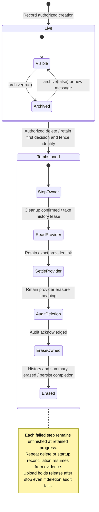
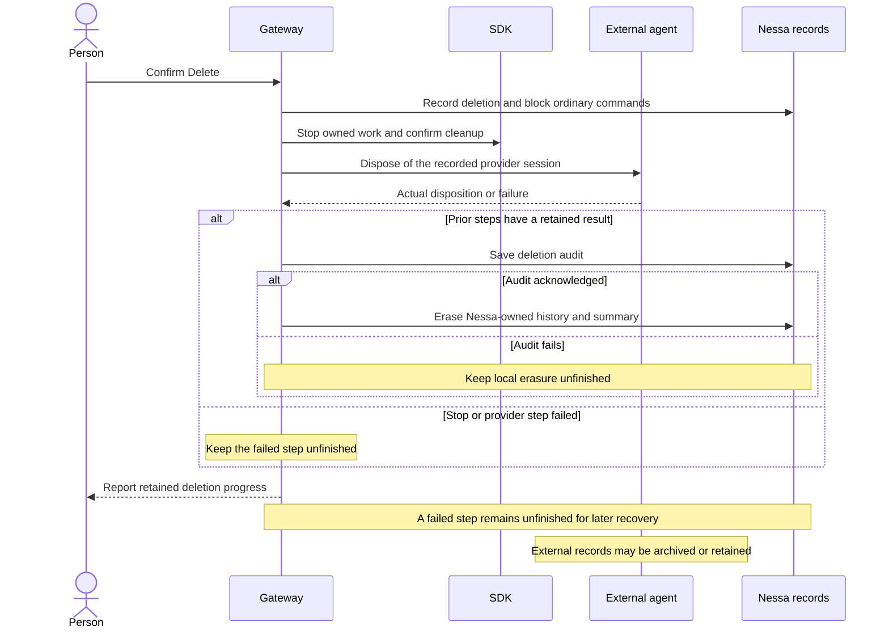
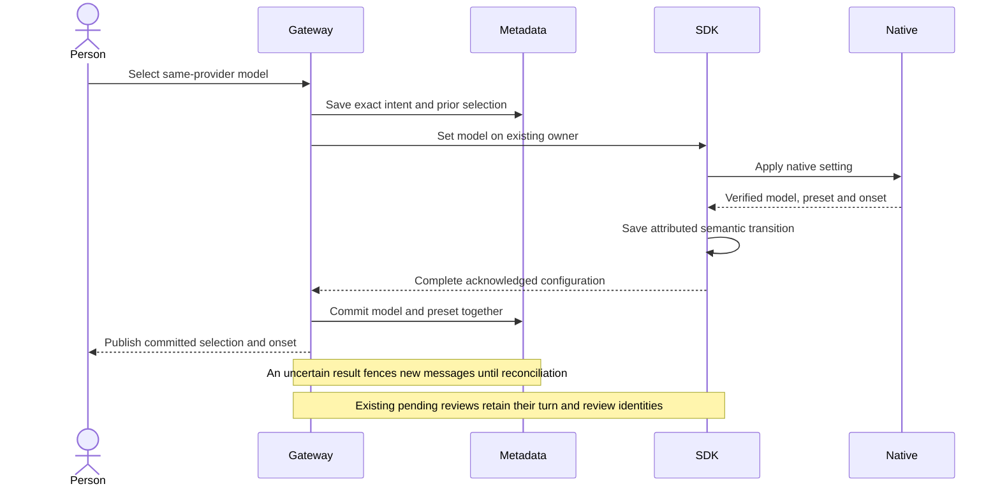

# Conversation identity and deletion

A conversation belongs to its original creator and organization. Archive changes whether it appears in lists while keeping its history and work.

Delete first records the decision and blocks ordinary commands under that identity. It then stops work, checks the provider's cleanup result and erases Nessa-owned data. Failed steps remain unfinished and can be resumed. The original decision stays attached to repeats; Nessa does not recreate the deleted identity.

## What external cleanup can mean

| Provider erasure evidence | Meaning |
| --- | --- |
| Deleted | Binding erases the provider-owned record. |
| Archived | Provider-owned record is retained as an archive. |
| Acknowledged | The provider accepted deletion; record disposition is not known. |
| NotListed | Delete was refused and a subsequent full list does not name it. |
| NotSupported / NoHandler | Provider retained its record; this path could not ask for erasure. |
| SessionUnknown | Leased local history does not establish the provider identity; do not claim no provider record. |

Nessa retains the reported provider result. Finishing local erasure does not change an archived or unknown external result into deleted.

## Deletion order

## Further reading

[Source](../../../../crates/nessa-server/src/conversation/application/service.rs) · [Related source](../../../../crates/nessa-server/src/conversation/domain/value_objects/conversation_deletion.rs) · [Related tests](../../../../crates/nessa-server/tests/conversation/deletion.rs)

## Live model selection

A same-provider model choice keeps the current native session and turn. The
provider acknowledges the application boundary: subsequent responses or the
next turn. The current turn's recorded model and permission decisions remain
historical facts.

The existing environment lease adapts a target factory to the same execution
place before the original lease fence wraps it. A remote target keeps its
already granted host connection and lease; it cannot fall back to a local
factory when workspace path text happens to match.

The conversation admission lock serializes model choices, permission presets
and new messages. `model_requests` keeps the original request, actor, prior
selection and observed result. The SDK's attributed `ModelChanged` record is
the native application evidence. Metadata commits the acknowledged model and
native approval preset together; admission then uses that binding's limits and
configured output reservation.

Recovery joins the exact actor, request, prior identity and acknowledged target
across both journals. It does not resend the model control. Without a matching
SDK fact, recovery retires the uncertain native generation and verifies the
committed prior configuration before releasing admission. Failed cleanup or
unreadable evidence leaves recovery required.

A pending selection has distinct publication and recovery admission. The
following table applies independently to mode and model requests: Open versus
LiveOnly, held versus free selection lock, and attached versus stopping versus
released owner cover all 24 combinations. Released means no live slot at read
entry; losing a captured owner during an await is refused separately.

| Selection lock | Owner | Open | LiveOnly |
| --- | --- | --- | --- |
| Held | Attached | Fresh guarded pending view; no recovery or opening | Same |
| Held | Stopping | Closed; no stale publication or new attachment | Same |
| Held | Released | Detached nonactionable pending view; no opening | Same |
| Free | Attached | Reconcile exact SDK evidence first; settle selection or return a fresh guarded pending view on failure | Pending view only; no recovery |
| Free | Stopping | Validate intent and retry that stopped owner's cleanup. While cleanup fails, refuse publication and retain intent without opening; after release, reconcile and open once | Closed; no cleanup |
| Free | Released | Reconcile pending request, then explicitly open the selected binding | Detached pending view; no opening |

If the lock is held before an intent becomes durable, wait for the lock and
follow the free row. A live owner that stops, disappears or changes during the
awaited title/access read cannot publish that captured view. Recovery does not
reuse a view captured before cleanup. `read_at` owns this ordering for both
controls; pending construction and final same-owner publication remain separate.

| Transition | Evidence |
| --- | --- |
| Durable preset intent admitted, native RPC held | `an_overlay_change_without_a_commit_is_delivered`: prior preset, Changing, unchanged SDK cursor; service notifies after durable admission and before dispatch |
| Original owner stops during pending title read | `a_pending_mode_view_rechecks_its_owner_after_the_title_wait`: no stale publication after retained stop or confirmed release |
| Unknown result and failed cleanup | `failed_session_retirement_keeps_mode_recovery_pending_without_a_second_open`: intent retained, no second open while blocked, explicit Open retries after cleanup is released |
| Known SDK acknowledgement and failed cleanup | `acknowledged_model_recovery_retries_the_stopped_owner` and `acknowledged_preset_recovery_retries_the_stopped_owner`: exact original fact settles without repeating native control |
| Native review still held during model control | `a_pending_model_control_keeps_the_original_review_answerable_after_caller_loss`: same turn/review, no request replay |
| Retained stopping owner on the wire | `retained_stopping_publication_refuses_wire_and_subscription_until_cleanup`: no replacement publication until cleanup confirms |

A preset request whose requested value equals its validated committed prior is a
journaled no-op. Its immutable request and original actor still own retries and
audits; no native control or SDK configuration record is produced. Pending reads
return the stable guarded prior view without waiting for the control lock. There
is no Changing overlay or intent notification for a selection that is unchanged.

| Unchanged preset ordering | Result and regression |
| --- | --- |
| Intent pending while control lock held | Stable view and cursor through Open and LiveOnly; no waiting behind the control; `an_unchanged_preset_pending_read_keeps_its_publication` |
| Terminal write lost before commit | Exact validated journal settles Applied on Open without native replay or retirement; `an_unchanged_preset_recovers_its_exact_request_without_retiring` |
| Original actor retries or reuses request for a different preset | Same no-op result, or RequestConflict for different intent; same test |
| Original review still pending on active turn | No native preset call, unchanged cursor, review remains answerable; `an_active_permission_preset_keeps_the_original_review_and_native_turn` |
| Owner stops during an awaited pending no-op read | Existing same-owner publication guard still refuses the view; no-op does not bypass lifetime checks |

The current alpha metadata format remains version 6. Opening requires the
current model-request table and columns before the gateway starts; an earlier
shape is refused as a dataset error and left intact. Opening does not add the
new table to an existing dataset or reset user data.
