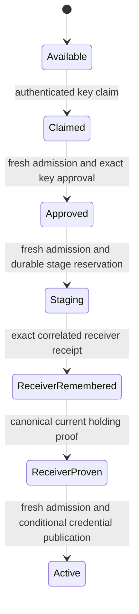

# Approve and activate a linked device

A device first claims an invitation with its authenticated key. Owner approval names that exact key; another key cannot replace the claim. Approval records consent, but does not yet make the device Active. Activation takes fresh current admission, reserves the credential and stage correlation, and owns that physical stage through receiver pairing and publication. A retry rejoins the same stage and receiver rather than issuing another credential.

The receiver result must match the reserved credential, request and generation. Before credential publication, the canonical receiver authority must still hold that pairing, active at its paired epoch or later with no intervening fence. Merely restoring the same credential after revocation is insufficient. A final fresh admission covers the registry revision advanced by staging and receiver evidence. Failure leaves Approved or Staging progress visible; it does not undo consent or report Active.

## Current holding and review evidence

The activation source holds the publication lock across receiver lookup and publication. The finite model treats that interval as one protected publication attempt. It includes held, revoked and fenced-then-regranted receiver alternatives, so only the held branch can reach Active. Its Active state is the publication instant, not a promise that later revocation cannot occur. Active-status reads independently recheck current holding.

Source inspection included the positive activation and retry controls, wrong-stage receiver rejection, revoked receiver remaining Staging, and intervening-fence rejection even after regrant. Those regression tests were read, not executed in this documentation task. Invitation PAKE crypto, rate/expiry limits, consent-phone proof, terminal cancellation cleanup, later credential revocation and physical network delivery remain outside this activation model.

## Bounded rule model

Owns exact-key consent, fresh revision-bound stage/publication admission and canonical current receiver proof before Active. Two device keys, one immutable stage and three receiver-history alternatives bound the model. Receiver receipt correlation is the successful Receiver action contract; cryptography and cancellation cleanup remain excluded. This finite abstraction checks safety only. It does not execute or verify the implementation, promise eventual completion, or qualify external effects. Existing source checkpoints and historical test receipts retain their earlier scope. The scoped model review inspected `crates/nessa-server/src/device_pairing/application/activation.rs`, `crates/nessa-server/src/device_pairing/application/owner.rs`, `crates/nessa-auth/src/application/pairing/stage.rs`.
