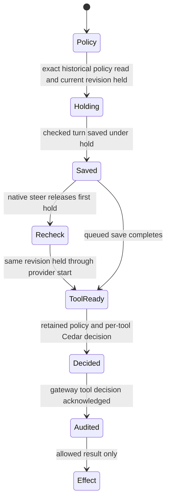

# Admit a Drive turn and its tool calls

A Drive turn names the grant and policy revision that admitted it. The gateway reads that historical policy and keeps it by both identities. Missing or unreadable policy refuses admission. Only a supported checked source attached in Ask mode with native hooks disabled can use this path; owner turns bypass this Drive-specific boundary.

The current grant revision is held while the turn is saved as checked. A queued save releases the hold after enqueueing. Native steering releases that first hold after the save, then reacquires the same revision before asking the provider. A revoke or policy replacement in that interval prevents steering; a saved turn alone is insufficient proof that injection happened. Historical policy remains the turn's policy even if the grant later changes. Eviction from the bounded retained-policy cache causes future calls to refuse rather than substituting another revision.

Gateway `run`, `artifacts_publish` and `artifacts_fetch` record the exact turn, call, grant, revision, actor and Cedar result before answering or running the call. A refused decision is also audited. An audit failure refuses the call. Permission-review hooks ask the same policy before asking a person; those refusals are saved through the SDK review owner rather than this gateway-tool audit path. Only calls the agent asks permission for reach that hook. The provider's Ask-mode read-only/offline floor remains outside this policy's ability to forbid operations.

## Review scope

The finite model follows one admitted grant revision, a possible replacement, queued versus native delivery and one gateway-tool decision. It checks save/steer revision evidence and decision-audit-before-effect. It excludes cryptography, exact policy text, provider-side operations that bypass permission review, the 64-entry cache eviction algorithm and durable command receipt restoration. Source and regression review covered revision-keyed policy lookup, missing/evicted policy refusal, J31 revision changes across admission/save/native-steer, and gateway decision audit. Regression sources were inspected, not executed. No eventual provider response is claimed.

[Environment command tools](environment-tools.md) own remote command terms and issued records after this Drive decision. [Provider permission reviews](../sdk/README.md) have their own broader lifecycle.

## Bounded rule model

Owns exact revision retention through save, native after-save revision recheck and one gateway-tool Cedar result audited before effect. Two grant revisions and queued/native modes bound the model. PolicyRead abstracts the supported-provider/Ask/no-native-hooks admission checks; review-hook persistence and provider-internal operations remain outside this gateway-tool audit abstraction. This finite abstraction checks safety only. It does not execute or verify the implementation, promise eventual completion, or qualify external effects. Existing source checkpoints and historical test receipts retain their earlier scope. The scoped model review inspected `crates/nessa-server/src/conversation/application/drive_tools.rs`, `crates/nessa-server/src/conversation/application/service.rs`, `crates/nessa-server/src/conversation/application/service/environment_tools.rs`.
