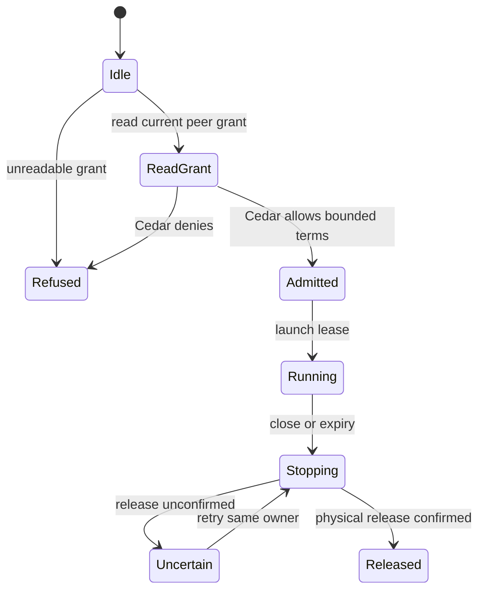

# Run harnesses through environment leases

The Unix environment role runs the gateway build installed on a remote host over SSH or a paired connection. It owns harness and command leases, not conversations. Each new request reads the peer grant again, asks Cedar and uses the terms from that same snapshot. Configuration can narrow available work further.

An unreadable grant refuses. Command timeouts cannot grow beyond the requested bound. Grant changes apply to later admissions rather than rewriting already-running leases. Losing a connection begins cleanup; an uncertain physical outcome retains its owner until confirmed release. Frame-loop, approval, redial and artifact transfers have separate bounded contracts.

## Bounded rule model

One admitted command explores requested and granted timeouts independently from one to two units, including a grant wider than the request; admission uses their minimum. This models the admission/ownership boundary. Policy is an external result. Observer loss, uncertain cleanup and confirmed release remain separate facts.

The configured safety rules are `RunningNeedsGrant`, `TermsNeverWiden`, `UncertainKeepsOwner`, `ReleasedIsConfirmed`. TLC explores the authored abstraction; it does not execute or prove the implementation.

| Model action | Source behavior abstracted |
| --- | --- |
| `ReadGrant` | Read one grant snapshot for this peer before lease admission. |
| `DenyUnreadable` | Refuse an unreadable grant instead of assuming default access. |
| `Admit` | Use Cedar allowance and timeout terms from the same grant snapshot. |
| `Deny` | Refuse a denied peer request without launching work. |
| `Launch` | Start the admitted lease through the injected launcher. |
| `LoseObserver` | Lose the response observer without certifying physical release. |
| `Stop` | Start owned lease cleanup after close, expiry or a stopped connection. |
| `Uncertain` | Retain the lease owner when cleanup cannot confirm release. |
| `Retry` | Retry cleanup against the same retained owner. |
| `Release` | Release ownership only after physical termination is confirmed. |

## Verification limits

The model does not represent grant-snapshot identities or concurrent grant changes; the source owns same-snapshot correlation. It omits lease renewal, process-group adapters, frame parsing, transfer digests, pairing, enrollment, self-update, fairness and multiple leases. Injected timer deadline ordering is documented in the source and is not a product task scheduler. No remote-provider execution was performed. The cited code and regression sources were inspected at the page checkpoint; their product test suites were not run in this modeling pass.

## Further reading

[grants.rs](../../../../crates/nessa-server/src/env_serve/application/grants.rs) · [serve.rs](../../../../crates/nessa-server/src/env_serve/application/serve.rs) · [admission.rs](../../../../crates/nessa-server/tests/env_serve/admission.rs)
