# Run a bounded environment command for a turn

The agent's environment list and `run` tool derive their initiator from a running turn under a live agent lease. The command policy asks Cedar about the host and program for that initiator. Agent-authored turns do not inherit the owner's command hosts. A Drive turn also needs its retained grant policy and an audited allowance for the gateway tool. Listing does not contact hosts or grant authority; without a usable turn or retained grant policy it offers no usable command hosts.

The selected environment grants a command lease. Its answer may shorten the requested timeout, but cannot lengthen it, change the sandbox, omit the timeout or add a lease-duration bound. A mismatched grant is dropped without running. The conversation then rechecks the current parent lease and capacity under the record lock. `CommandIssued` saves the actual granted terms, original actor and exact parent before `run` is invoked. An unsaved issue does not run, even when retained records still need a later save.

```mermaid
stateDiagram-v2
    [*] --> Source
    Source --> Policy: running turn and live agent lease
    Policy --> Grant: current command policy permits
    Grant --> Granted: environment returns matching narrowed terms
    Granted --> Issued: original live parent and capacity; CommandIssued saved
    Issued --> Running: invoke owned command
    Running --> Done: collect result and retain end evidence
    Grant --> Refused: terms widened or host refused
    Granted --> Refused: parent moved, full or issue unsaved
```

Artifact offers are collected while the command is live. The attachment owner checks the offered bytes, confirms a conversation hold and records the file under the correct lease. Refused recording triggers claim-specific rollback; uncertain cleanup is not an assertion that the bytes were removed. Finishing the command does not release a conversation's kept attachment. Published results remain bounded independently of command output.

Caller loss requests stop and still waits for the command outcome. `CommandEnded` persistence is distinct from physical exit: a result can truthfully report `recorded: false`, retaining evidence for a later save. Parent-lease replacement does not authorize attributing that end to a new lease.

## Review scope

The model uses one original live parent, one command, requested and returned timeouts independently in one through two units, a matching or foreign sandbox and one artifact. It checks term refusal, durable issue before run, and valid held bytes before an attributed artifact record. It abstracts successful Drive/source-policy checks as admission actions. It excludes timeout clock ordering, process cleanup, artifact digest implementation, output/file budgets, host redial, command-end save retries and list rendering. Those belong to the separate [environment host lease](environment-leases.md), [Drive admission](drive-tool-admission.md) and [attachment hold](attachments/have-a-large-or-unfamiliar-image-normalized-and-kept-once.md) owners. Regression sources inspected include no-running-turn, agent-authored refusal, unsaved issue, narrowed/widened timeout/sandbox, caller-loss stop, publication recording and late end evidence. Product tests were not executed here.

## Bounded rule model

Owns source-to-command admission, timeout/sandbox narrowing, saved issue before invocation and one artifact hold/record relationship. One lease and artifact plus two independent timeout bounds keep exploration finite. PolicyAllows abstracts actual current Cedar admission, not a policy implementation; process release, end-audit retries and physical artifact rollback are excluded. This finite abstraction checks safety only. It does not execute or verify the implementation, promise eventual completion, or qualify external effects. Existing source checkpoints and historical test receipts retain their earlier scope. The scoped model review inspected `crates/nessa-conversation/src/application/service/environment_tools.rs`, `crates/nessa-conversation/src/application/artifacts.rs`.
