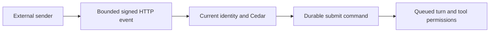
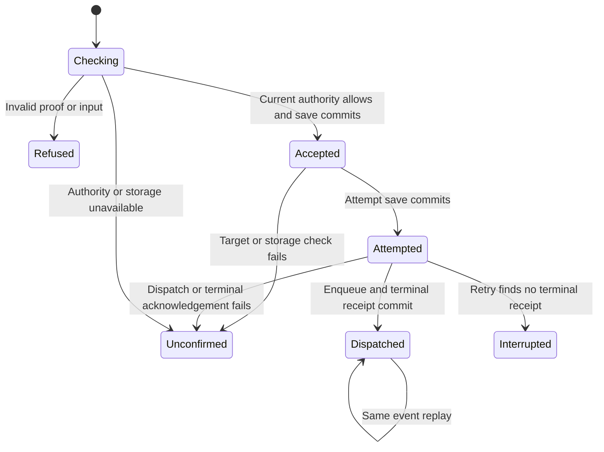

# External event admission

A signed HTTP event can queue one turn in an existing conversation. The binding
chooses the conversation and authenticated Nessa identity. Event payloads cannot
choose either. The optional router is a library primitive; the production gateway
does not mount it. GitHub and Linear registration and provider-specific signature
adapters remain future work.

This is a webhook, not a persistent bidirectional WebSocket connection. It is
separate from outbound event delivery in #896 and frontend lifecycle work in #1087.

## Proving an event came from its sender

The HTTP adapter checks a binding-specific HMAC over the exact body and timestamp.
It rejects missing, repeated or invalid signature headers, stale or future proofs,
and invalid JSON. The body has a 16 KiB bound and a five-second read deadline.
Eight owned slots cover body reading and admission until a command result. A task
retains the slot after handoff even when the response future is cancelled. The
listener owns connection and header limits and TLS; this router creates no listener.

The [wire contract and ordering table](../../../design/external-events.md) describe
how to sign an event. These are Nessa headers, not native GitHub or Linear headers.

## Current permission for a fixed target

The binding holds a session created through Nessa Auth. Every event and replay
reads current credential and membership state, then asks the existing Cedar
`conversation.write` action. A revoked binding or missing grant cannot replay an
old success. Conversation ownership, deletion checks and tool permissions retain
their existing owners. The payload is untrusted data in the queued user message.

## Acknowledging admission

Trigger and delivery identities determine stable request and execution identities.
The existing command coordinator saves admission and attempted dispatch before
asking the SDK to enqueue. A settled receipt is durable before HTTP returns 202.
Concurrent deliveries of the same event compete for one durable command lease. An overlap may return 503 and can be retried with the same identity. Changed payloads
under the same identity conflict. This primitive introduces no second durable
queue or background redelivery worker. Each request retains at most three bounded
command records. Distinct event identities still grow the existing record store;
there is no total stream quota or timed receipt pruning in this slice.

The chart shows durable Accepted and Attempted stages alongside observed HTTP
outcomes. Unconfirmed and Interrupted are response outcomes, not new persisted
receipt stages. An interrupted receipt remains Attempted in the command store.

## An interrupted delivery

A lost answer can leave the sender unsure whether admission happened. It should
retry the same delivery identity with a fresh signature. If the durable record
shows an attempt without a terminal outcome, the router returns 409 interrupted.
It does not automatically repeat the effect. An operator must inspect the saved
turn before deciding whether a new event is appropriate. A 503 likewise does not
prove the absence of effects. The sender retains failed deliveries.

## Execution and cancellation

202 means dispatched, not completed. The existing conversation view reports the
turn's execution, failure or pending permission. Exact-turn stop cancels through
the existing command API. Replaying the same event after a failed or cancelled
turn returns its original dispatch receipt. An intentional new execution needs a
new event identity. No exactly-once external tool-effect guarantee is made.

## Validation and review scope

The new HTTP tests use a real loopback listener, real Cedar, the SQLite command
store and the SDK runner, with test-only credentials and a deterministic provider.
They exercise invalid proofs, malformed and oversized bodies, duplicate concurrency,
current authority changes, storage failure, execution failure and lost terminal
acknowledgement through restart. Deterministic cancellation of Axum service futures
checks capacity before and after command handoff; this does not simulate a TCP reset.
An admission-task failure returns uncertainty and recovers capacity. The design
table links inherited command recovery
and cancellation behavior. No production provider registration or external workflow
effects are exercised. The 16 feature tests passed on Linux. The affected package test run passed its
other targets but retains one failing, unchanged Codex process-cleanup test;
see [verification evidence](../../../../verification/external-events/README.md).
The full seven-package CI Clippy selection passed with `-D warnings`.
This page reviews the source commit named above. The gateway index change is
navigation only; unrelated state pages were not re-audited.
