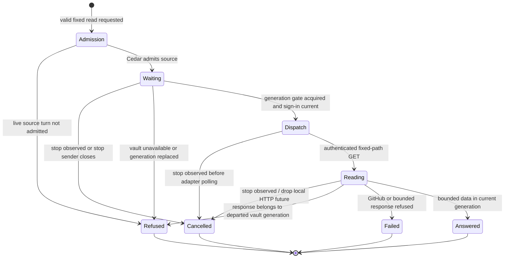

# GitHub reads

An agent can ask the gateway for repository, issue or pull request metadata.
The gateway checks the source turn and performs the read with the current GitHub
sign-in. The agent receives bounded data, without Nessa's bearer token or git
credential helper. Raw `gh`, `git clone` and `git push` no longer receive Nessa's
credentials. Separately configured machine credentials have their own boundary.

This chart follows one brokered read. It starts after parsing the fixed operation
and repository arguments; invalid input is refused before source admission.

## Cancellation and disconnect

The connection owner serializes reads and sign-in changes within one vault
unlock generation. A queued cancelled call settles without waiting for an older
GET and without dispatching another request. If stop and the gate or adapter
answer are ready together, the read-only tool gives stop priority. An answer
already returned to its caller is not changed by a later stop.

Disconnect in the same generation waits for an uncancelled local read. Stopping
an in-flight read drops its HTTP future and frees that gate. A GET already sent
may have reached GitHub; cancelling the local wait does not undo a remote request.
The loopback regression holds a real HTTP response open, cancels the queued and
active reads, then checks Disconnect and local socket closure.

## Vault and event ownership

A new unlock owns a separate gate and does not wait on an old-generation GET.
Queued old reads cannot borrow its sign-in, and old responses are refused after
a generation change. The existing encrypted vault entry, verified legacy
migration/removal, and live-event relay remain owned by their existing services.
Product Disconnect retains its live-event cleanup before forgetting the sign-in.
See [the local vault](local-vault.md) and [the GitHub design and ordering tables](../../../design/github-connect.md).

This is read-only credential containment. It adds no brokered writes and makes
no OS-level isolation claim about unconfined processes sharing the unlocked
gateway's user identity. [Issue 1195](https://github.com/nessalabs/nessa-agent/issues/1195)
tracks the remaining process boundary. The vault encrypts ordinary persistence;
a plaintext `sign-in.json` is legacy migration input rather than the normal store.

## Review scope

The checkpoint covers the broker, generation gate, response fencing, composition
and the named regression tests at the source revision above. It does not advance
unrelated vault, relay, or conversation checkpoints. Executed check results and
remaining environment limits are recorded in [the credential evidence](../../../../verification/desktop/evidence/github-credential/README.md).
