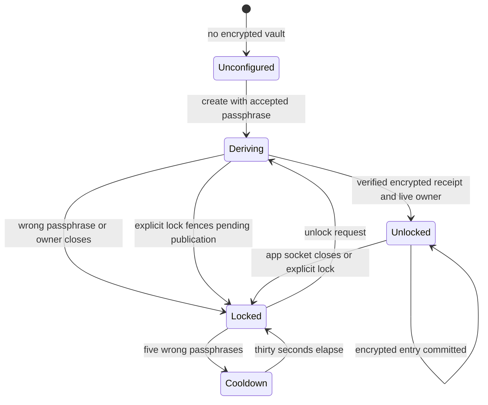

# Local vault

Onboarding asks for a passphrase of at least twelve characters. Protected GitHub
use can ask later if setup was skipped. Unlock lasts across window reloads until
Nessa quits, the gateway restarts, or the owning app explicitly locks the vault.
Ordinary workspace use can continue while protected data is locked.

The diagram follows configured storage once creation commits. A creation failure
before the encrypted receipt leaves it unconfigured. A failure after a durable
receipt preserves the file and requires unlock; Nessa never silently resets it.

The shared vault uses Argon2id with 64 MiB memory, three iterations and one lane,
then XChaCha20-Poly1305 with a fresh nonce for each atomic file write. Its fixed
format bounds file size, entry count and secret size. SQLCipher encrypts the inbox
and its rollback journal using a separate random key held in that vault. The
passphrase and derived key are not stored beside the encrypted files. A copied
vault can still be attacked offline; a long, unique passphrase matters. Nessa
cannot recover a forgotten passphrase. This does not protect against malware
running as the user while Nessa is unlocked.

One native app retains one authenticated child connection over private pipes.
Window reloads share that connection. Closing its input interrupts pending work
and invalidates the unique server-side owner before a late key can publish.
Another app connection cannot take over or lock a live owner's unlock.
GitHub cache and storage work retain the unlock generation that admitted them.
A delayed result cannot overwrite or delete a newer session's credentials.
Locking terminates a pending sign-in with its original operation and caller,
even when the key-close audit reports failure. Secret
access remains subject to the gateway's existing credential and Cedar checks.

Existing GitHub credentials and inbox keys may need one final OS-store unlock for
import. Nessa verifies encrypted receipts before deleting each old entry. Missing
keys, unreadable data or failed retirement preserve the old ciphertext and refuse
protected use. After a successful import, normal setup and unlock do not access
the OS credential store.

A bounded local audit records lifecycle and named-entry changes without passwords,
keys, tokens or event payloads. Audit failure refuses new unlocks and writes;
locking still clears retained key material. Cloudflare's existing relay remains
on Free and sees incoming webhook plaintext before encrypted retention. This vault
does not provide end-to-end webhook encryption.

Direct CLI relay commands use `--passphrase-stdin` for a process-scoped unlock.
Passphrases are never command arguments or environment settings. The native
`vault session` pipe protocol is app infrastructure, not a stored-secret read API.
