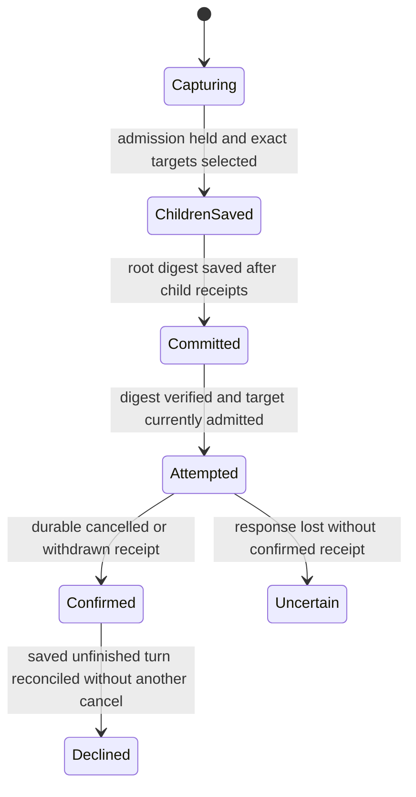

# Stop the captured parent turn and descendants

Stop captures the requested parent execution and eligible owned queued or active descendant executions while admission is held. It does not select every later execution on those conversations, close their lifetimes, or make the threads unusable. Report-created inputs on the parent are withdrawn before its active root turn is cancelled; a failed withdrawal prevents root cancellation from advancing the queue past the intended Stop.

Accepted child Stop bindings are saved before the aggregate root binding. The root digest binds their ordered exact identities, actor, request, target and turn. A prefix locates candidates but supplies no authority. Partial children without a root marker cannot authorize effects. Restart verifies the complete selection and reuses those targets, even if cascade settings or current work changed. Each physical target still passes its ordinary current authorization.

## Recovery and limits

The finite model uses one parent, one captured child and one unrelated later turn. It separates the selected set, saved child receipts, aggregate root digest, validated recovery, attempted physical cancels and confirmed receipt-based history decline. An attempted but unconfirmed target stays uncertain; recovery cannot infer success or resend its cancellation. Confirmed cancelled or withdrawn receipts allow saved unfinished history to be declined without repeating the physical command. Root acknowledgement additionally requires the selected child receipts to be settled.

This source review inspected the owner, exact selection digest restoration, captured-stop attribution and confirmed-stop recovery, plus regressions for partial settlement/lost acknowledgement, restart without settings reinterpretation, stale parent Stop and reusable threads. Those application tests were read, not executed here. Graph traversal completeness, report withdrawal ordering, release evidence, provider cancellation, metadata/storage failure and cross-organization authorization are excluded from the finite model. No lifetime sealing or eventual completion is claimed.

## Bounded rule model

Owns child-before-root persistence, exact aggregate selection proof on recovery, exclusion of later/unrelated turns and confirmed-receipt history decline. Identity digests are modeled as exact target sets, abstracting collision-resistant ordered hashes. Attempt sets preserve no-resend uncertainty; authority checks and report-withdrawal order remain external action prerequisites. This finite abstraction checks safety only. It does not execute or verify the implementation, promise eventual completion, or qualify external effects. Existing source checkpoints and historical test receipts retain their earlier scope. The scoped model review inspected `crates/nessa-server/src/conversation/application/service/parent_stop.rs`.
