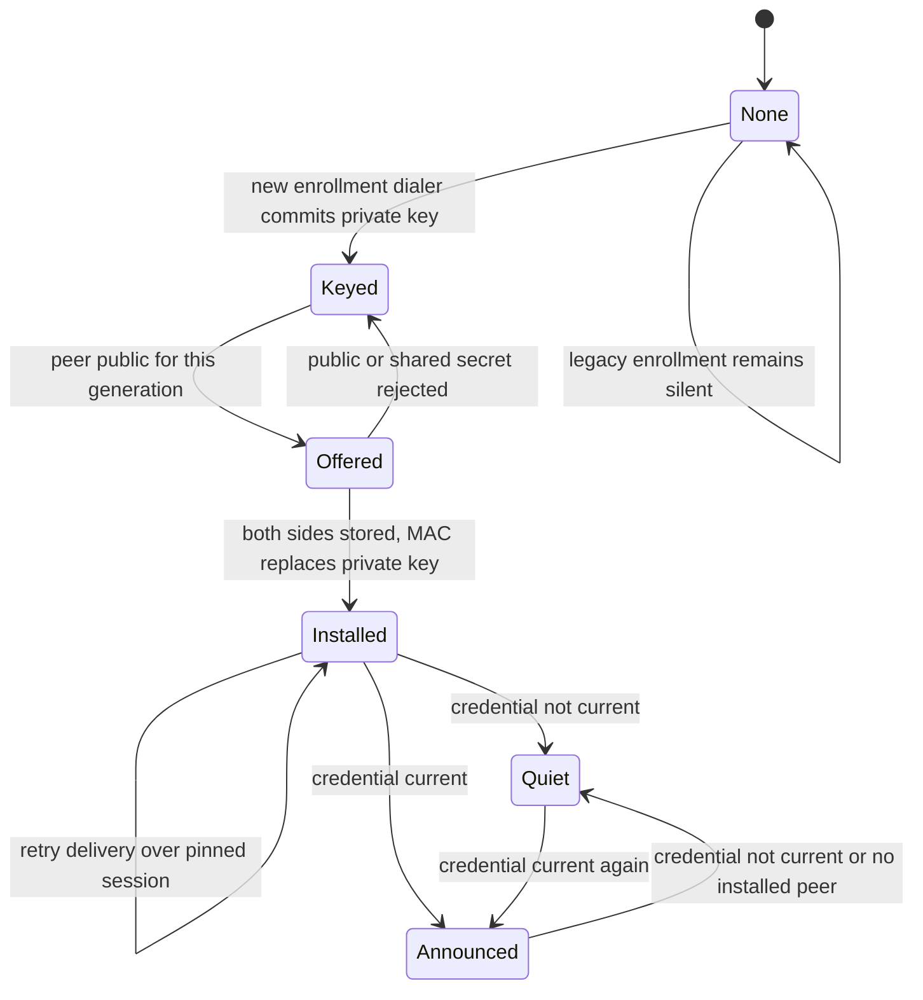

# Announce a paired gateway on the local network

A gateway with a paired peer whose discovery field is installed and whose credential is current may announce a dial address, a port, and one rotating token for that peer. The token is an HMAC of the time window, the address, and the port, keyed by the discovery MAC both sides stored beside the pinned key. The announcement does not carry the pinned key, a fingerprint, or another stable gateway id. Hearing it does not enroll anyone. The connection is still the pinned credential, and pairing still requires the one-use code.

With no such peer, or with a revoked or expired credential, nothing is sent. Expiry does not change the phase and does not remove the discovery key. A peer with no discovery key is left out.

## Restart and re-pairing

New dialer enrollments retain discovery eligibility when their pending record is saved. Older records without that field stay silent after upgrade. Once Active, an eligible enrollment retries the pinned exchange even when its own MAC is installed: a saved local key does not prove the peer received the acknowledgement. Token refresh runs independently of retry progress. Stop withdraws the announcement before joining the current attempt, and the scheduler does not start another peer. Network phases share 5-second connect, 10-second TLS, and 30-second exchange budgets; physical storage and worker drain are joined rather than relabelled complete.

On the granting gateway, discovery chooses the current Active enrollment for the peer key. Each write carries that enrollment’s invitation identity and rechecks its current credential. A historical pairing cannot capture a write meant for a later pairing of the same key.

## Model coverage

The configured safety rules are `AnnounceOnlyInstalled` and `ExpiryKeepsPhase`. The model keeps the phase Active while the credential expires, and it allows an announcement only for an installed field with a current credential. It does not model the X25519 derivation, the HMAC bytes, or the DNS-SD registration. Those are held by the discovery tests. The model also excludes legacy enrollment eligibility, scheduling retries, and selection among historical enrollments; the record and registry regressions cover those boundaries.

## Verification limits

The model does not execute the implementation. Window arithmetic, address canonicalization, reconnect of an offered record, and the refusal of `openDiscovery` from an unpaired key are in `crates/nessa-peer-gateways/tests/discovery.rs` and the grantor registry test.
