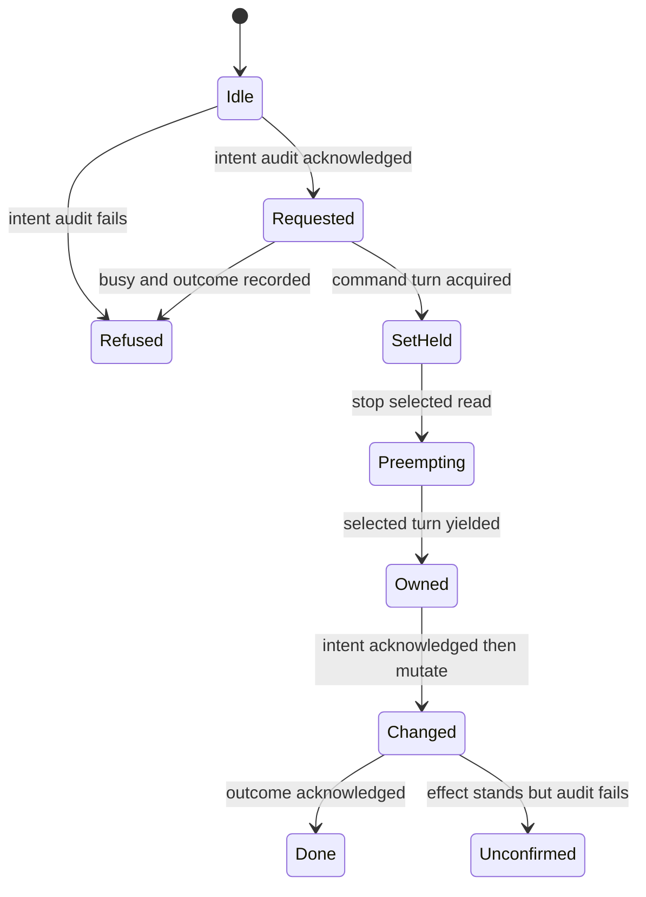

# Enroll, read and forget peer gateways

A gateway can enroll into another gateway invitation, retain the peer identity, read its granted records, change its relay or forget it. Product admission asks Cedar before the command. Commands serialize record-set changes and stop only the selected peer read; unrelated peer cycles keep running.

Intent audit precedes the command turn, including its Busy check and peer-read preemption. A successful reply also waits for outcome audit. If audit fails after mutation, the effect can already stand and the list is the recovery view. Pollers queue change evidence under their peer turn, then release that turn before waiting for its audit acknowledgement.

## Bounded rule model

One command, its selected peer read and an unrelated peer cycle model record-set admission, preemption and audit ordering. The changed flag records an applied effect independently of successful acknowledgement.

The configured safety rules are `MutationHasIntent`, `SuccessHasBothRecords`, `OtherPeerUninterrupted`, `CommandCannotRaceSelectedRead`, `PreemptionNeedsIntent`. TLC explores the authored abstraction; it does not execute or prove the implementation.

| Model action | Source behavior abstracted |
| --- | --- |
| `Acquire` | Acquire the record-set command turn before preempting a peer read. |
| `Busy` | Return Busy before interrupting any read when another command owns the set. |
| `Preempt` | Stop only the selected peer cycle and wait for its turn. |
| `Own` | Take the selected peer turn after its read yields. |
| `Intent` | Acknowledge intent before taking the record-set turn or interrupting any read. |
| `Change` | Apply enrollment, relay or forget through the owned record set. |
| `Complete` | Acknowledge the outcome before returning successful command completion. |
| `AuditFails` | Retain an effect already applied when its outcome audit cannot be confirmed. |

## Verification limits

Enrollment cryptography, deadline clocks, per-peer cached stream cursors, credential rotation, relay races and filesystem durability are abstracted. This does not model every poller recovery path or establish current remote authority. The cited code and regression sources were inspected at the page checkpoint; their product test suites were not run in this modeling pass.

## Further reading

[commands.rs](../../../../crates/nessa-server/src/peer_gateways/infrastructure/commands.rs) · [commands.rs](../../../../crates/nessa-server/tests/peer_gateways/commands.rs) · [poller.rs](../../../../crates/nessa-server/src/peer_gateways/infrastructure/poller.rs)
