# Wait for busy record discovery within one read

An admitted physical history read can find its stream's discovery cache entry checked out by another reader. That answer is `Occupied`: no validation happened. The read waits for its own stream to become available, or for its existing work budget to end, then tries again. Another stream staying checked out does not prolong this wait. A wake only permits another checkout attempt; a competing reader can still acquire the entry first.

A real `Preparing` answer spends one validation step and retains discovery progress for later calls. The read still stops after 128 validating steps or its 200 ms discovery budget. The budget starts when the worker has a thread, has checked stream identity and is about to start discovery. Worker queue time is outside that budget. Capacity remains owned across the queue, occupied wait and actual source join.

```mermaid
stateDiagram-v2
    [*] --> Queued
    Queued --> Discovering: worker ready after identity lookup; start budget
    Discovering --> Waiting: Occupied; no validation step spent
    Waiting --> Discovering: this stream can be checked out; retry
    Discovering --> Discovering: Preparing; spend one validating step
    Discovering --> Ready: validated result
    Discovering --> Preparing: work budget or validating-step bound
    Waiting --> Preparing: work budget elapsed; wake occupied wait
    Ready --> Joined: source joined; release source capacity
    Preparing --> Joined: source joined; release source capacity
```

Occupied is not an unlimited promise to keep the watch alive. Still occupied when the work budget ends returns `source_preparing`; the client's existing four preparing attempts can still end an unready source. A ready operation can win the budget race before the stop boundary. Caller-drop or worker shutdown also stops discovery and wakes an occupied wait. Socket disconnection is different: the mounted route detaches its read task, allowing bounded discovery and cleanup to finish. The broader [read ownership model](record-reads.md) keeps timeout, physical source join, queued response ownership and network send separate.

## Review and finite bounds

The model uses two validating steps, an abstract elapsed-budget flag, this stream and one unrelated stream. It represents a worker queued before its clock begins, occupied/preparing distinction, a competing checkout after wake, enabled resumption when this stream is free even while the unrelated stream stays occupied, and source capacity through join. Enabled resumption is an available transition, not fairness or eventual readiness. Ready and Preparing are returned read outcomes, not persisted conversation states.

This source checkpoint covers this narrow read/wait policy at the integrated main source. The source and regression inspection included occupied answers not spending steps, elapsed budget stopping occupied work, real Preparing spending a step, one stream returning while another stays checked out, and worker queue time not exhausting discovery time. Those application/SDK tests were read, not executed here. Byte validation, scope admission, cache eviction/corruption, condition-variable implementation, exact clock durations, client retry state and scheduler fairness remain outside this model. Unbounded SDK scans have a different wait/deadline contract and are not modeled as this admitted read.

## Bounded rule model

Owns bounded physical discovery queue timing, occupied-versus-validating work accounting and same-stream retry availability. Two validating steps stand for the unchanged 128-step bound; elapsed time is an environment event, not measured milliseconds. A busy unrelated stream stays checked out throughout. Caller/worker stop wakeups and client retry budgets are described source boundaries, not additional liveness claims. This finite abstraction checks safety only. It does not execute or verify the implementation, promise eventual completion, or qualify external effects. Existing source checkpoints and historical test receipts retain their earlier scope. The scoped model review inspected `crates/nessa-server/src/conversation/infrastructure/record_read/operation.rs`, `crates/nessa-server/src/conversation/infrastructure/record_read/source.rs`, `crates/nessa-sdk/src/infrastructure/session_storage/terminal_discovery.rs`.
