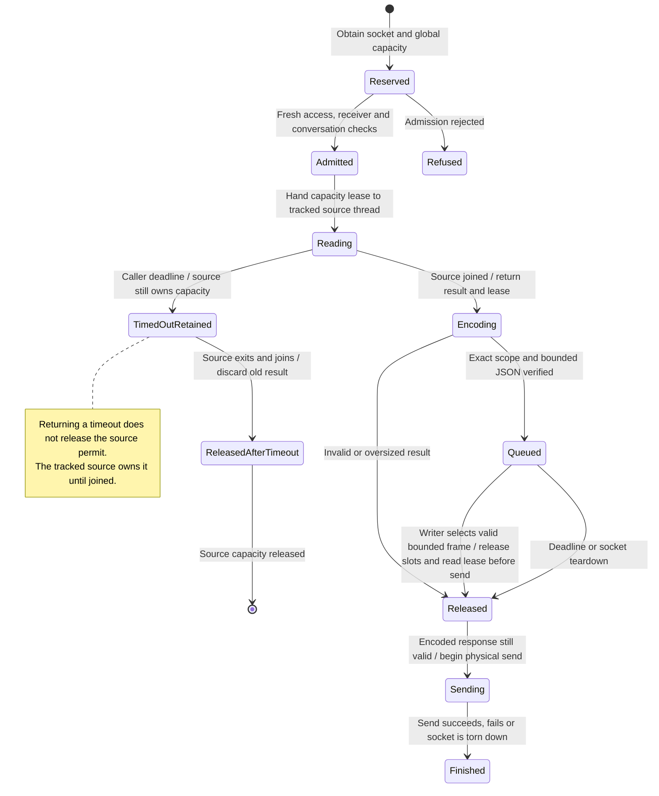

# Bounded physical history reads

An authorized reader can page through saved conversation records without starting an agent. Nessa limits both the number of records and the bytes in each response.

The read holds its source and capacity until completion, timeout and cleanup have settled. Closing the socket does not instantly make unfinished read resources available. After the source joins, response ownership remains while queued and is released after encoding and size checks, before any physical send. A stalled send does not keep that read lease. Downloading records and applying them to a receiver's local history are separate steps.

The chart follows the mounted receiver route. The principal entry below is an
inner use case and is not mounted as a product command or background reader.

## Principal source reads

A registered webhook principal can be checked for one conversation without a
receiver binding or product session. The inner use case first reserves the
composition-owned global read slot without waiting. It then holds the current
credential, holds that principal's exact grant revision and asks the existing
webhook Cedar policy against the actual conversation metadata. Another chat,
organization, owner or credential, a stopped lifetime, or a stale epoch refuses
before physical source I/O. Capacity refusal starts no authority wait.

Principal and receiver selectors remain different types and entrypoints. The
principal selector uses the existing registration UUID as its opaque replication
consumer ID, matching the durable outbox. It does not construct a receiver or
use paired-reader authority. Both entries use the existing tracked SDK worker,
physical identity checks, discovery limits and source join. The receiver entry
continues through its original opened-source validator.

The actual credential and grant fences travel with the physical read lease.
Cancelling the waiter leaves those fences and capacity with the worker until
physical cleanup completes. A normal bounded result retains the same fences;
access checks absolute expiry again. No mutex guard crosses an await, and the
worker does not acquire the result's inspection mutex. The application validates
requested and returned selectors and uses the canonical sync page validator
under composition-selected limits. A retained selector from an earlier grant
epoch cannot be used after unshare and regrant.

SDK frame payloads are binary. Later webhook composition must use the existing
recordsPage encoder and preserve its wire-record JSON, rather than treating a
frame payload as JSON. An isolated compatibility test performs that encoding and
queues both actual synthetic frames through the existing durable outbox while
the result retains its fences. Other source tests assert no physical read or
cursor/delivery change on refusal. No HTTP adapter or recipient is mounted in
these tests. A sender still requires independent current admission before POST.

## Source review checkpoint

Reviewed source `ebe4f93e8dae4bbbdda9f571e8db57a03c0a8e59` against this page's
prior checkpoint and published cancellation head `d947da064`. The receiver
record-read application/dispatch and client deadline fixture are unchanged;
the shared physical operation now selects the original receiver validator or
the explicit principal validator. The product socket's unrelated Auth-origin
changes retain fresh session/Cedar admission and do not create a webhook session.

Author checks passed204 webhook tests,12 canonical physical-reader tests, the
receiver scope test, seven-package Clippy,108 architecture tests/check, formatting
and diff checks. [Scoped evidence](../../../reviews/evidence/webhook-runtime/principal-source/README.md)
distinguishes ten restored mutation controls before the consumer-ID correction,
the failing/passing real outbox compatibility case, and initial fixture failures.
Fresh independent ownership review is pending. Runtime mounting, share resolution,
supervised source/sender ownership, recipient E2E and platform/browser qualification
of this source remain open. The existing chart was not visually re-rendered; no
Nessa Docs renderer checkout is available here. Unrelated state pages retain
their previous source revisions.

## Further reading

[Source](../../../../crates/nessa-server/src/product/socket.rs) · [Related source](../../../../crates/nessa-server/src/product/record_read/dispatch.rs) · [Related tests](../../../../crates/nessa-client-core/tests/read_only_sync/gateway/deadline_stream.rs)
