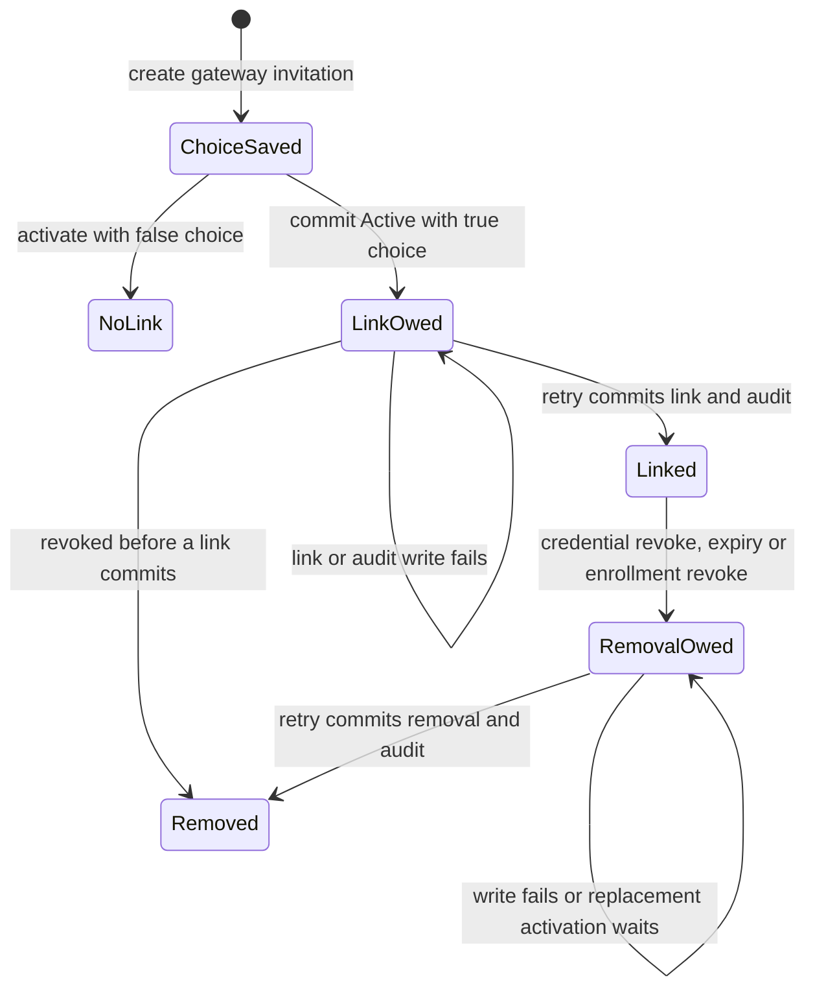

# Pair a gateway as the same person

An owner creating a gateway invitation can choose that the gateway acts for the
same person. A true choice requires its authoritative owner principal to be
Human. The normal bootstrap owner credential is Human, including when used by
`nessa call` as the `nessa-cli` caller. A separately provisioned Integration
surface is a different principal: an admin role or a CLI/desktop caller label is
not person provenance. Such a surface receives an ineligible refusal for true.
Ordinary false-choice pairing is unchanged. After pairing, a granted read reports the gateway principal and
that person together. The association grants no access: an unshared conversation
still cannot be read, and comment or drive remain subject to the existing Cedar
policies. A gateway paired without the choice reports no person.

For example, the owner's laptop and desktop can each have a separate read grant
on one conversation. Their shared person does not collapse those grants. Device
and owner-phone consent retain their own classes and cannot select this choice.

## Supported API and desktop entry

The [local auth guide](../../../guides/local-auth.md) explains that
`auth init --local` creates the Human owner credential and by default writes it
to `auth/surfaces/nessa-cli.token`. A custom owner output is selected with
`--credential-file` on online commands. With an already provisioned owner
credential, the supported API call is:

```sh
nessa call pairing.create --params '{"enrollee":"gateway","samePerson":true}' \
  --credential-file /absolute/path/to/owner.token
```

The native route regression runs this request through the real CLI catalog,
schema validation and product transport against a throwaway gateway. It checks
that the saved invitation names the authoritative Human. It also checks that a
provisioned admin Integration is refused without changing invitations/revision.
The caller label never supplies the person identity.

Create, pending, status, approval and terminal replies expose the canonical
`samePerson` choice for peer invitations, including false. It survives an owner
restart. Non-peer replies omit it; absence on a legacy response remains unknown,
not an inferred false. This is historical consent, never evidence that a person
link committed or a read is authorized.

The [desktop gateway invitation](../desktop/workspace/gateway-pairing.md) now
provides a separate PeerRead entry and a creation-only same-person choice. Its
selected proof is explicit Human reauthentication through the existing credential
authority. The ordinary panel keeps its Integration credential; no durable
Integration-to-Human relation is inferred or established. Phone and Computer
retain their OwnerPhone and Environment classes. The desktop page owns the
separate session's consent, teardown and recovery; this page's native lifecycle
checkpoint remains unchanged. Desktop evidence and its source checkpoint are
recorded on that page and in the
[completion evidence](../../../reviews/893-desktop-completion.md).

## Choice, activation and recovery

`pairing.create` stores `samePerson` on the immutable invitation. The authenticated
exchange binds both true and false, and the client retains the exact choice.
Changing it in transit prevents pairing. Restart before activation restores it.

The credential registry remains the activation owner. It commits Active, the
credential and receiver first. The existing grant owner then commits the person
link and its audit together in
`<namespace>/access-grants/access-grants.sqlite3`. These are two commits.
An error can therefore return an Active receipt with `activationStopped`; the
credential was issued, but attribution remains owed. Reapproving uses the same
credential and receiver. The next grant write and startup use the same
reconciler. Read admission reports the person only after the link commits.

The chart follows the link obligation, not a new enrollment phase. A grant still
has its independent subject, capabilities and epoch throughout this flow.



## Removal retains its cause

Credential revocation or enrollment cancellation commits in the credential
registry first. Removal then uses the original revoking principal or local
operator, or the expiry initiator and cause, including live retries and restart.
The domain record retains its
original terminal event through history replay: cancellation must match its
Explicit revocation and command time, independent revocation must match its
exact original transition, and a pre-Active cancellation cannot supply an issued
credential. Custom effect sources consume this same correlation validator. Link and removal audit cannot commit
partially. Grant rows and their epochs do not change. Exclusive expiry uses the
fixed credential expiry; if revocation also occurs, the earlier boundary retains
its meaning as time advances.

A later enrollment of the same gateway key waits while an old link remains,
including when the new choice is false. Cleanup names the exact old credential,
so it cannot remove a later association. A committed removal is a durable receipt
that prevents replaying the consumed invitation after restart or clock rollback,
including when expiry was observed before the first link could commit.
Ordinary device and owner-phone activation do not perform an unrelated owed
same-person insertion.

## Grant storage boundary

The grant file lives outside `conversations/`, so opening it does not create
conversation data or change retirement accounting. Startup repair and credential
revocation cleanup remain bound when native linking is disabled and when no
agent is configured. The peer gateway retains the choice in its private record
through activation and restart.

The grant file has its own current schema version. A different version is refused
before conversation metadata is opened, and is never migrated or rewritten.
Read-only backup snapshots apply the same version and shape checks. Legacy grant
rows in conversation metadata remain unused and unchanged. Paired grants use
receiver subjects; unpaired grants use principal subjects. Their export identities
include that kind, so equal text in the two namespaces cannot collide.

## Review scope and limits

This page traces the source at the checkpoint above and the focused regression
fixtures listed in Sources. Execution receipts and deliberate failure probes are
recorded in the pull request and its linked review evidence. The chart has no
formal model; the older device activation model does not cover these two-store
link obligations. No real device, account grant, live credential, physical phone
or deployed gateway was used to verify this flow. Peer subscriptions, desktop
choice controls and unrelated gateway lifecycle models are outside this change.
